## 引言

随着演化，UNIX 主要有两种风格：System V 和 BSD 。POSIX.1 在两种风格基础上制定了终端 I/O 标准。  

终端 I/O 系统的复杂，主要由于应用比较多：终端、计算机之间的连接、调制解调器、打印机等。  


## 综述

终端 I/O 有两种工作模式：

* 规范模式：对终端输入以行为单位。每个读请求终端驱动程序最多返回一行。
* 非规范模式：不装配成行。

默认是规范模式。处理整个屏幕的程序，例如 vi 编辑器一般使用非规范模式。


终端设备通常是由位于内核的终端驱动程序控制，每个终端设备都有一个输入队列和一个输出队列。  

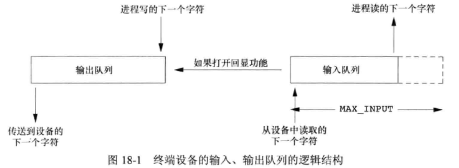

* 如果打开了回显功能，则在输入队列和输出队列之间有一个隐含连接。
* 输入队列的长度 MAX_INPUT 是有限值。当一个特定设备输入队列已经填满，行为取决于具体实现。
* 另一个限制是 MAX_CANON。限制规范输入行的最大字节数。
* 输出队列通常也有限制。但通常程序不能获取这个限制值，由内核控制，即将填满时内核将写进程陷入休眠，直到写队列有可用的空间。
* 冲洗函数 tcflush 可以刷新输入、输出队列。 


大多数 UNIX 系统在一个 **终端行规程(terminal line discipline)** 的模块中进行全部的规范处理。

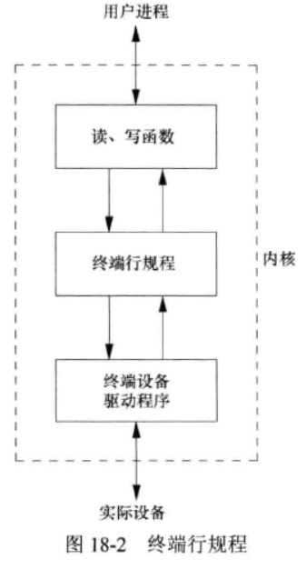

这样将规范处理分离为单独的模块，所有终端驱动程序都能够一致地支持规范处理。  

所有可以检测和更改终端设备地特性都包含在 termios 结构中。该结构定义在 <termios.h> 头文件中。  

```c
struct termios {
    tcflag_t c_iflag; /* input flags */
    tcflag_t c_oflag; /* output flags */
    tcflag_t c_cflag; /* control flags */
    tcflag_t c_lflag; /* local flags */
    cc_t c_cc[NCCS]; /* control characters */
};
```


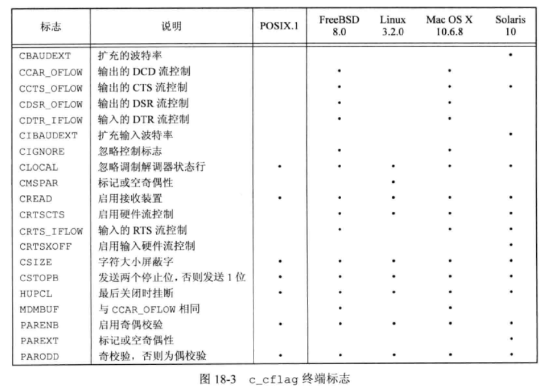

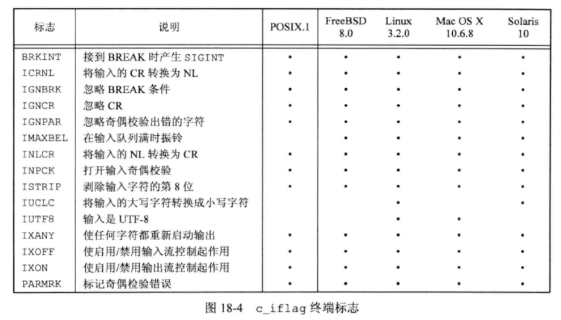

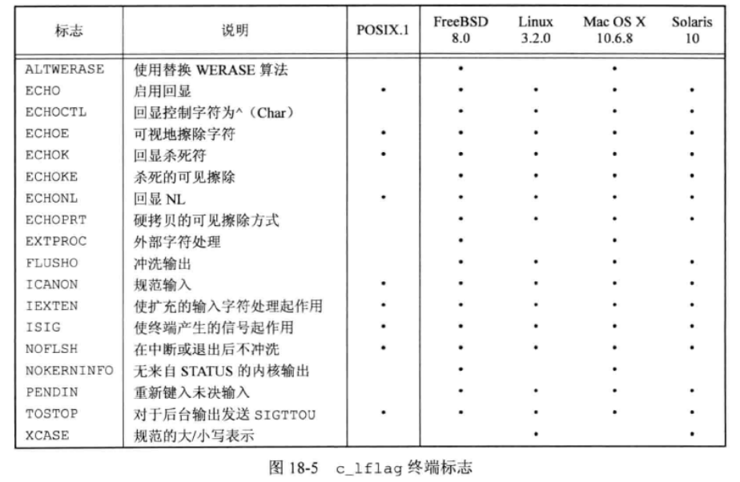

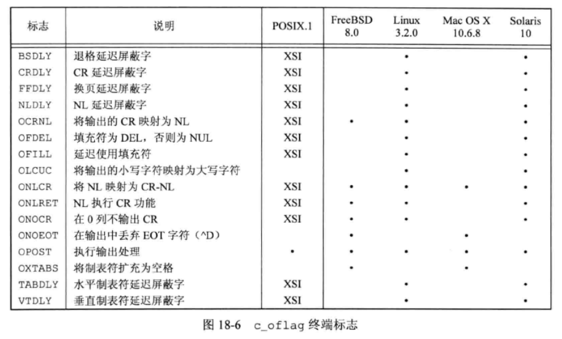

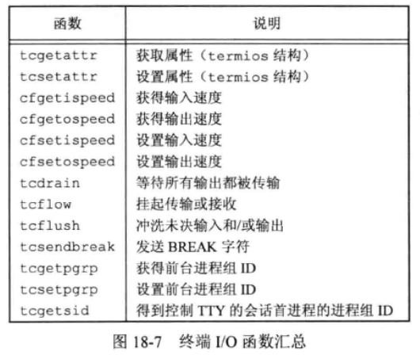

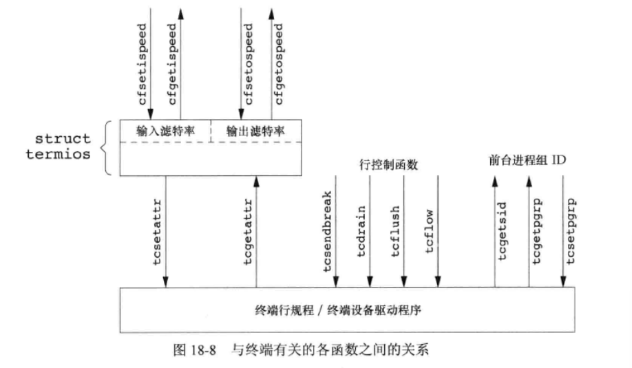


## 特殊输入字符

POSIX.1 定义了 11 个在输入时要特殊处理的字符。

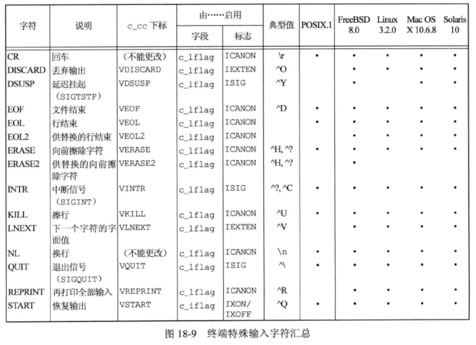

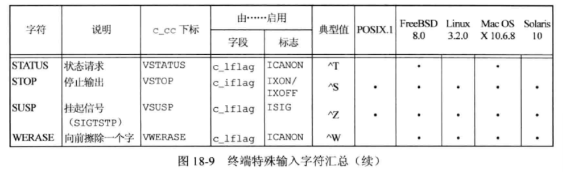

11个特殊字符中，除了换行符和回车符，其它9个字符可以任意更改。  

POSIX.1 也允许禁止使用这些字符，将 c_cc 数组中的某项值设置为 _POSIX_VDISABLE 的值就可以禁止相应特殊字符。  

示例，禁止中断字符，将文件结束符设置为 Ctrl+B：

```c
#include "apue.h"
#include <termios.h>

int main(void){
    struct termios term;
    long vdisable;
    
    if(isatty(STDIN_FILENO) == 0)
        err_quit("standard input is not a terminal device");
    
    if((vdisable = fpathconf(STDIN_FILENO, _PC_VDISABLE)) < 0)
        err_quit("fpathconf error or _POSIX_VDISABLE not in effect");
    
    if(tcgetattr(STDIN_FILENO, &term) < 0)
        err_sys("tcgetattr error");
    
    term.c_cc[VINTR] = vdisable;
    term.c_cc[VEOF] = 2;
    
    if(tcsetattr(STDIN_FILENO, TCSAFLUSH, &term) < 0)
        err_sys("tcsetattr error");
    
    exit(0);
}
```

* 仅当标准输入时终端设备时才修改中断特殊字符， isatty 是对此进行检测
* 用 fpathconf 获取 _POSIX_VDISABLE 值
* 函数 tcgetattr 从内核获取 termios 结构。修改此结构后调用 tcsetattr 函数设置属性，只有希望修改的属性被更改，其余属性保持不变。
* 禁用中断键与忽略中断信号是不同的。上面只是禁用使终端驱动程序产生的 SIGINT 信号的特殊字符，仍可以使用 kill 函数发送信号到进程。


各个特殊字符，这些字符中大多数在终端驱动程序识别并进行特殊处理后被丢弃，并不返回给执行读终端进行操作的进程：

* CR ：回车符，不能更改此字符
* DISCARD：丢弃符。
* DSUSP：延迟挂起作业控制字符。
* EOF：文件结束符。
* EOL：附加的行界定符，与 NL 作用相同。
* EOL2：另一个行界定符，与 NL 作用相同。
* ERASE：向前擦除字符（退格）。规范模式中不会超越行首去擦除上一行中的字符。
* ERASE2：供替换的向前擦除字符（退格）。
* INTR：中断字符。
* KILL：杀死字符，但应该被称为 行擦除符，擦除一整行。
* LNEXT：下一个字符的字面值。
* NL：换行字符，也成为行界定符。
* QUIT：退出字符。
* REPRINT：再打印字符。
* START：启动字符。
* STATUS：BSD 的状态请求字符。
* STOP：停止字符。
* SUSP：挂起作业控制字符。
* WERASE：字擦除字符。

除此之外需要为终端设备定义的另一个字符是 BREAK 字符。在异步串行数据传送时发生的一个条件。根据接口不同，可以有多种方式通知设备驱动程序发生了 BREAK 条件。  


## 获得和设置终端属性

为了获得和设置 termios 结构，可以调用 tcgetattr 和 tcsetattr 函数。

```c
#include <termios.h>

int tcgetattr(int fd, struct termios *termptr);

int tcsetattr(int fd, int opt, const struct termios *termptr);
		// 成功返回0，出错返回-1
```

两个函数都有一个指向 termios 结构的指针作为参数，它们返回当前终端的属性，或者设置该终端的属性。若 fd 没有引用终端设备则出错返回 -1， errno 设置为 ENOTTY。  

tcsetattr 的参数 opt 使得我们可以指定在什么时候新的终端属性才起作用。 opt 可以指定为下列常量之一：

* TCSANOW：更改立即发生
* TCSADRAIN：发送了说有输出后更改才发生。
* TCSAFLUSH：发送了所有输出后更改才发生。在更改发生时维度的所有输入数据都被丢弃。

tcsetattr 函数的返回状态需要进一步检验，通过调用 tcgetattr 将实际终端属性和所希望的属性相对比。  


## 终端选项标志

书中这里列出所有不同的终端选项标志，指出每个选项出现在 4 个终端标志字段中的哪一个。  

所有选项标志（除所谓的屏蔽字标志外）都用一位或多位表示。屏蔽字标志定义多个位，它们组合在一起，可以定义一组值。屏蔽字标志有一个定义名，每个值也有一个名字。例如，为了设置字符长度，先用字符长度屏蔽字 CSIZE 将表示字符长度的位清零，然后设置下列值之一：CS5、CS6、CS7、CS8。  

示例，使用屏蔽字标志取或设置一个值：

```c
#include "apue.h"
#include <termios.h>

int main(void){
    struct termios term;
    
    if(tcgetattr(STDIN_FILENO, &term) < 0)
        err_sys("tcgetattr error");
    
    switch(term.c_cflag & CSIZE){
        case CS5:
            printf("5 bits/byte\n");
            break;
        case CS6:
            printf("6 bits/byte\n");
            break;
        case CS7:
            printf("7 bits/byte\n");
            break;
        case CS8:
            printf("8 bits/byte\n");
            break;
        default:
            print("unkonw bits/byte\n");
    }
    
    term.c_cflag &= ~CSIZE;
    term.c_cflag |= CS8;
    if(tcsetattr(STDIN_FILENO, TCSANOW, &term) < 0)
        err_sys("tcsetattr error");
    
    exit(0);
}
```


选项标志：

* ALTWERASE：c_lflag，若输入 WERASE 字符，则使用一个替换的字擦除算法。
* BRKINT：c_iflag，若已设置此标志，而未设置 IGNBRK，则在接到 BREAK 时，冲洗输入、输出队列，并产生一个 SIGINT 信号。
* BSDLY：c_oflag
* CBAUDEXT：c_cflag
* CCAR_OFLOW：c_cflag
* CCTS_OFLOW：c_cflag
* CDSR_OFLOW：c_cflag
* CDTR_IFLOW：c_cflag
* CIBAUDEXT：c_cflag
* CIGNORE：c_cflag
* CLOCAL：c_cflag
* CMASPAR：c_oflag
* CRDLY：c_oflag
* CREAD：c_cflag
* CRTSCTS：c_cflag
* CRTS_IFLOW：c_cflag
* CRTSXOFF：c_cflag
* CSIZE：c_cflags
* CSTOPB：c_cflag
* ECHO：c_lflag
* ECHOCTL：c_lflag
* ECHOE：c_lflag
* ECHOK：c_lflag
* ECHOKE：c_lflag
* ECHONL：c_lflag
* ECHOPRT：c_lflag
* EXTPROC：c_lflag
* FFDLY：c_oflag
* FLUSHO：c_lflag
* HUPCLL：c_lflag
* ICANON：c_lflag
* ICRNL：c_iflag
* IEXTEN：c_lflag
* IGNBRK：c_iflag
* IGNCR：c_iflag
* IGNPAR：c_iflag
* IMAXBEL：c_iflag
* INLCR：c_iflag
* INPCK：c_iflag
* ISIG：c_lflag
* ISTRIP：c_iflag
* IUCLC：c_iflag
* IUTF8：c_iflag
* IXANY：c_iflag
* IXOFF：c_iflag
* IXON：c_iflag
* MDMBUF：c_cflag
* NLDLY：c_oflag
* NOFLSH：c_lflag
* NOKERNINFO：c_lflag
* OCRNL：c_oflag
* OFDEL：c_oflag
* OFILL：c_oflag
* OLCUC：c_oflag
* NLCR：c_oflag
* ONLERT：c_oflag
* ONOCR：c_oflag
* ONOEOT：c_oflag
* OPOST：c_oflag
* OXTABS：c_oflag
* PARENB：c_cflag
* PAREXT：c_cflag
* PARMRK：c_iflag
* PARODD：c_cflag
* PENDIN：c_lflag
* TABDLY：c_oflag
* TOSTOP：c_lflag
* VTDLY：c_oflag
* XCASE：c_lflag


## stty 命令

程序中可以使用 tcgetattr 、tcsetattr 函数进行检查和修改终端选项。在命令行中可以使用 stty 命令进行检查和更改。  
示例，WSL ubuntu 24 中的选项：

```bash
xmy@xmy:~$ stty -a
speed 38400 baud; rows 36; columns 209; line = 0;
intr = ^C; quit = ^\; erase = ^?; kill = ^U; eof = ^D; eol = <undef>; eol2 = <undef>; swtch = <undef>; start = ^Q; stop = ^S; susp = ^Z; rprnt = ^R; werase = ^W; lnext = ^V; discard = ^O; min = 1; time = 0;
-parenb -parodd -cmspar cs8 -hupcl -cstopb cread -clocal -crtscts
-ignbrk -brkint -ignpar -parmrk -inpck -istrip -inlcr -igncr icrnl ixon -ixoff -iuclc -ixany -imaxbel -iutf8
opost -olcuc -ocrnl onlcr -onocr -onlret -ofill -ofdel nl0 cr0 tab0 bs0 vt0 ff0
isig icanon iexten echo echoe echok -echonl -noflsh -xcase -tostop -echoprt echoctl echoke -flusho -extproc

```

若选项前有一个连字符 `-` 则表示该选项禁用。


## 波特率函数

**波特率(baud rate)**是一个历史沿用的术语，指的是“位/秒”(bit per second)。大多数终端设备对输入和输出使用同一波特率，但是如果硬件允许，可以设置为不同值。  

```c
#include <termios.h>

speed_t cfgetispeed(const struct termios *termptr);
speed_t cfgetospeed(const struct termios *termptr);
		// 上面两个函数返回波特率值

int cfsetispeed(struct termios *termptr, speed_t speed);
int cfsetospeed(struct termios *termptr, speed_t speed);
		// 成功返回0，出错返回-1
```

上面两个 cfget 函数返回值，以及两个 cfset 的 speed 参数是这些常量之一：B50、B75、B110、B150、B200、B300、B600、B1200、B1800、B4800、B9600、B19200、B38400。常量 B0 表示“挂断”。很多系统定义了另外的波特率值，例如 B57600、B115250。    

使用上面的函数时，要调用对应获取、设置终端属性的函数，例如先 tcgetattr 获取设备 termios 结构，再调用 cfget 函数，调用 cfset 函数之后，要调用 tcsetattr 函数设置 termios 结构中的波特率。


## 行控制函数

下面4个函数提供了终端设备的行控制能力。

```c
#include <termios.h>

int tcdrain(int fd);
int tcflow(int fd, int action);
int tcflush(int fd, int queue);
int tcsendbreak(int fd, int duration);
		// 成功返回0，出错返回-1
```

* tcdrain 函数等待所有输出都被传递。
* tcflow 函数用于对输入和输出流控制进行控制。action 参数必定是如下4个值之一：
  * TCOOFF：输出被挂起
  * TCOON：重新启动以前被挂起的输出
  * TCIOFF：系统发送一个 STOP 字符，将使得终端设备停止发送数据
  * TCION：系统发送一个 START 字符，将使得终端设备恢复发送数据
* tcflush 函数冲洗输入缓冲区或者输出缓冲区。queue 参数必须是如下3个常量之一：
  * TCIFLUSH：冲洗输入队列
  * TCOFLUSH：冲洗输出队列
  * TCIOFLUSH：冲洗输入队列和输出队列
* tcsendbreak 函数在一个指定时间区间内发送连续的0值位流。若 duration 参数为 0，则此种传递延续 0.25~0.5 秒。POSIX.1 声明若 duration 非 0，传递时间依赖于实现。


## 终端标识

大多数 UNIX 历史版本中控制终端的名字是 /dev/tty 。POSIX.1 提供了一个运行时函数，用来确定终端名字：

```c
#include <stdio.h>

char *ctermid(char *ptr);
		// 成功返回指向控制终端名的指针，出错返回指向空字符串的指针
```

ptr 非空则会指向一个长度至少为 `L_ctermid` 字节的数组，进程的控制终端名称存放在该数组中，`L_ctermid` 存放在 stdio.h 中。如果 ptr 为空，该函数为数组分配空间，进程控制终端名存放在分配的空间中。  


## 规范模式

规范模式：发一个读请求，当一行已经输入后，终端驱动程序返回。以下条件会造成读返回：

* 所请求的字节已经读到时，读返回。
* 当读到一个行界定符时，读返回。
* 如果捕捉到信号，并且该函数不再自动重启，则读也返回。


getpass 函数，读取用户在终端上键入的口令。此函数由 login、crypt 程序调用。为了读取口令，该函数必须关闭回显，仍可以使终端以规范模式进行工作。典型实现示例：

```c
#include	<signal.h>
#include	<stdio.h>
#include	<termios.h>

#define	MAX_PASS_LEN	8		/* max #chars for user to enter */

char *
getpass(const char *prompt)
{
	static char		buf[MAX_PASS_LEN + 1];	/* null byte at end */
	char			*ptr;
	sigset_t		sig, osig;
	struct termios	ts, ots;
	FILE			*fp;
	int				c;

	if ((fp = fopen(ctermid(NULL), "r+")) == NULL)
		return(NULL);
	setbuf(fp, NULL);

	sigemptyset(&sig);
	sigaddset(&sig, SIGINT);		/* block SIGINT */
	sigaddset(&sig, SIGTSTP);		/* block SIGTSTP */
	sigprocmask(SIG_BLOCK, &sig, &osig);	/* and save mask */

	tcgetattr(fileno(fp), &ts);		/* save tty state */
	ots = ts;						/* structure copy */
	ts.c_lflag &= ~(ECHO | ECHOE | ECHOK | ECHONL);
	tcsetattr(fileno(fp), TCSAFLUSH, &ts);
	fputs(prompt, fp);

	ptr = buf;
	while ((c = getc(fp)) != EOF && c != '\n')
		if (ptr < &buf[MAX_PASS_LEN])
			*ptr++ = c;
	*ptr = 0;			/* null terminate */
	putc('\n', fp);		/* we echo a newline */

	tcsetattr(fileno(fp), TCSAFLUSH, &ots); /* restore TTY state */
	sigprocmask(SIG_SETMASK, &osig, NULL);  /* restore mask */
	fclose(fp);			/* done with /dev/tty */
	return(buf);
}

```

* 调用 ctermid 函数打开控制终端，而不是直接将 /dev/tty 写在程序中
* 只是读、写控制终端，如果不能以读、写模式打开此设备则出错返回。
* 阻塞两个信号：SIGINT、SIGTSTP。如果不阻塞，输入 INTR 字符时会使得程序异常终止，并使终端仍处于禁止回显状态。
* 使用标准 I/O 读、写控制终端。
* 最多只存储8个字符作为口令。

调用上面函数的示例：

```c
#include "apue.h"

char *getpass(const char *);

int main(void){
    char *ptr;
    
    if((ptr = getpass("Enter password:")) == NULL)
        err_sys("getpass error");
    printf("password: %s\n", ptr);
    
    while(*ptr != 0)
        *ptr++ = 0;
    exit(0);
}
```


## 非规范模式

可以通过关闭  termios 结构中 `c_lflag` 字段的 ICANON 标志来指定非规范模式。在非规范模式中，输入数据不被装配成行，不处理下列特殊字符：ERASE、KILL、EOF、NL、EOL、EOL2、CR、REPRINT、STATUS、WERASE。  

在规范模式中系统每次最多返回一行，但在非规范模式下如何返回？  

当以读了指定量的数据后，或者已经超过了给定量的时间后，通知系统返回。  

这里使用了 termios 结构中的 c_cc 数组的两个变量：MIN 和 TIME。c_cc 数组中的这两个元素的下标名为 VMIN 和 VTIME。  

MIN 指定一个 read 返回前的最小字节数。TIME 指定等待数据到达的分秒数。有4种情形：

* MIN>0，TIME>0：
  * 定时器超时前，已接收到 MIN 个字节则 read 返回 MIN 个字节。
  * 若在接到 MIN 字节之前，定时器已超时，则 read 返回已接收到的字节。
  * 定时器实在第一个字节被接收后启动的，因此至少会返回一个字节
  * 第一个字节被接收之前，调用者会一直阻塞
* MIN>0，TIME==0：接收到 MIN 个字节之前不返回，可能会造成 read 无限期阻塞
* MIN==0，TIME>0：TIME指定一个调用 read 时启动的读定时器，在接收到一个字节或者该定时器超时，read 立即返回，若超时则返回0。
* MIN==0，TIME==0：如果有数据可用，read 最多返回所要求的字节数，若无数据可用，read 立即返回0。


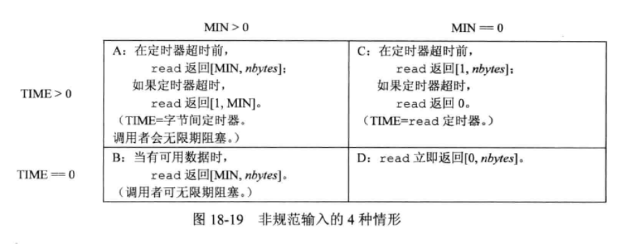


示例：

* 函数 tty_cbreak，将终端设置为 cbreak 模式(cbreak mode)
* 函数 tty_raw，将终端设置为原始模式(raw mode)。 
* 函数 tty_reset ，将终端恢复到原始的工作状态
* 函数 tty_atexit，可被登记为退出处理程序，以保证 exit 恢复终端工作模式
* 函数 tty_termios，返回一个指向原来规范模式下 termios 结构的指针


```c
#include "apue.h"
#include <termios.h>
#include <errno.h>

static struct termios		save_termios;
static int					ttysavefd = -1;
static enum { RESET, RAW, CBREAK }	ttystate = RESET;

int
tty_cbreak(int fd)	/* put terminal into a cbreak mode */
{
	int				err;
	struct termios	buf;

	if (ttystate != RESET) {
		errno = EINVAL;
		return(-1);
	}
	if (tcgetattr(fd, &buf) < 0)
		return(-1);
	save_termios = buf;	/* structure copy */

	/*
	 * Echo off, canonical mode off.
	 */
	buf.c_lflag &= ~(ECHO | ICANON);

	/*
	 * Case B: 1 byte at a time, no timer.
	 */
	buf.c_cc[VMIN] = 1;
	buf.c_cc[VTIME] = 0;
	if (tcsetattr(fd, TCSAFLUSH, &buf) < 0)
		return(-1);

	/*
	 * Verify that the changes stuck.  tcsetattr can return 0 on
	 * partial success.
	 */
	if (tcgetattr(fd, &buf) < 0) {
		err = errno;
		tcsetattr(fd, TCSAFLUSH, &save_termios);
		errno = err;
		return(-1);
	}
	if ((buf.c_lflag & (ECHO | ICANON)) || buf.c_cc[VMIN] != 1 ||
	  buf.c_cc[VTIME] != 0) {
		/*
		 * Only some of the changes were made.  Restore the
		 * original settings.
		 */
		tcsetattr(fd, TCSAFLUSH, &save_termios);
		errno = EINVAL;
		return(-1);
	}

	ttystate = CBREAK;
	ttysavefd = fd;
	return(0);
}

int
tty_raw(int fd)		/* put terminal into a raw mode */
{
	int				err;
	struct termios	buf;

	if (ttystate != RESET) {
		errno = EINVAL;
		return(-1);
	}
	if (tcgetattr(fd, &buf) < 0)
		return(-1);
	save_termios = buf;	/* structure copy */

	/*
	 * Echo off, canonical mode off, extended input
	 * processing off, signal chars off.
	 */
	buf.c_lflag &= ~(ECHO | ICANON | IEXTEN | ISIG);

	/*
	 * No SIGINT on BREAK, CR-to-NL off, input parity
	 * check off, don't strip 8th bit on input, output
	 * flow control off.
	 */
	buf.c_iflag &= ~(BRKINT | ICRNL | INPCK | ISTRIP | IXON);

	/*
	 * Clear size bits, parity checking off.
	 */
	buf.c_cflag &= ~(CSIZE | PARENB);

	/*
	 * Set 8 bits/char.
	 */
	buf.c_cflag |= CS8;

	/*
	 * Output processing off.
	 */
	buf.c_oflag &= ~(OPOST);

	/*
	 * Case B: 1 byte at a time, no timer.
	 */
	buf.c_cc[VMIN] = 1;
	buf.c_cc[VTIME] = 0;
	if (tcsetattr(fd, TCSAFLUSH, &buf) < 0)
		return(-1);

	/*
	 * Verify that the changes stuck.  tcsetattr can return 0 on
	 * partial success.
	 */
	if (tcgetattr(fd, &buf) < 0) {
		err = errno;
		tcsetattr(fd, TCSAFLUSH, &save_termios);
		errno = err;
		return(-1);
	}
	if ((buf.c_lflag & (ECHO | ICANON | IEXTEN | ISIG)) ||
	  (buf.c_iflag & (BRKINT | ICRNL | INPCK | ISTRIP | IXON)) ||
	  (buf.c_cflag & (CSIZE | PARENB | CS8)) != CS8 ||
	  (buf.c_oflag & OPOST) || buf.c_cc[VMIN] != 1 ||
	  buf.c_cc[VTIME] != 0) {
		/*
		 * Only some of the changes were made.  Restore the
		 * original settings.
		 */
		tcsetattr(fd, TCSAFLUSH, &save_termios);
		errno = EINVAL;
		return(0);
	}

	ttystate = RAW;
	ttysavefd = fd;
	return(1);
}

int
tty_reset(int fd)		/* restore terminal's mode */
{
	if (ttystate == RESET)
		return(1);
	if (tcsetattr(fd, TCSAFLUSH, &save_termios) < 1)
		return(0);
	ttystate = RESET;
	return(1);
}

void
tty_atexit(void)		/* can be set up by atexit(tty_atexit) */
{
	if (ttysavefd >= 1)
		tty_reset(ttysavefd);
}

struct termios *
tty_termios(void)		/* let caller see original tty state */
{
	return(&save_termios);
}

```

cbreak 模式的定义如下：

* 非规范模式。
* 关闭回显。
* 每次输入一个字节。

原始模式的定义如下：

* 非规范模式。
* 关闭回显。
* 禁止输入中的 CR 到 NL 映射（ICRNL）、输入奇偶校验检测（INPCK）、玻璃输入字节的第8位（ISTRIP）、输出流控制（IXON）。
* 8位字符（CS8），且禁用奇偶校验。
* 禁止所有输出处理（OPOST）。
* 每次输入一个字节（MIN=1，TIME=0）。


测试上面的原始模式和 cbreak 模式示例：

```c
#include "apue.h"

static void
sig_catch(int signo)
{
	printf("signal caught\n");
	tty_reset(STDIN_FILENO);
	exit(0);
}

int
main(void)
{
	int		i;
	char	c;

	if (signal(SIGINT, sig_catch) == SIG_ERR)	/* catch signals */
		err_sys("signal(SIGINT) error");
	if (signal(SIGQUIT, sig_catch) == SIG_ERR)
		err_sys("signal(SIGQUIT) error");
	if (signal(SIGTERM, sig_catch) == SIG_ERR)
		err_sys("signal(SIGTERM) error");

	if (tty_raw(STDIN_FILENO) < 0)
		err_sys("tty_raw error");
	printf("Enter raw mode characters, terminate with DELETE\n");
	while ((i = read(STDIN_FILENO, &c, 1)) == 1) {
		if ((c &= 255) == 0177)		/* 0177 = ASCII DELETE */
			break;
		printf("%o\n", c);
	}
	if (tty_reset(STDIN_FILENO) < 0)
		err_sys("tty_reset error");
	if (i <= 0)
		err_sys("read error");
	if (tty_cbreak(STDIN_FILENO) < 0)
		err_sys("tty_cbreak error");
	printf("\nEnter cbreak mode characters, terminate with SIGINT\n");
	while ((i = read(STDIN_FILENO, &c, 1)) == 1) {
		c &= 255;
		printf("%o\n", c);
	}
	if (tty_reset(STDIN_FILENO) < 0)
		err_sys("tty_reset error");
	if (i <= 0)
		err_sys("read error");

	exit(0);
}

```

执行测试：

```bash
xmy@xmy:~/cProgram/apue_src/chapter_18$ ./18.21 
Enter raw mode characters, terminate with DELETE
                                                4
                                                 33
                                                   133
                                                      61
                                                        70
                                                          176

Enter cbreak mode characters, terminate with SIGINT
4
1
10
177
signal caught
xmy@xmy:~/cProgram/apue_src/chapter_18$ 

```

这里通过 xshell 运行，原始模式中测试了 Ctrl+D 和功能键 F7，按下Ctrl+退格触发cbreak 模式，cbreak 模式下测试了 Ctrl+D、Ctrl+A、退格、Ctrl+退格、Ctrl+C。


## 终端窗口大小

大多数 UNIX 系统都提供一种跟踪当前终端窜口大小的方法，在窗口大小发生变化时，使内核通知前台进程组。内核为每个终端和伪终端都维护了一个 winsize 结构：

```c
struct winsize {
    unsigned short ws_row;
    unsigned short ws_col;
    unsigned short ws_xpixel;
    unsigned short ws_ypixel;
}
```

* 使用 ioctl 的 TIOCGWINSZ 命令可以获取此结构的当前值
* 使用 ioctl 的 TIOCSWINSZ 命令可以将此结构的新值存储到内核中。如果此新值于存储在内核中的当前值不同，则前台进程组会收到 SIGWINCH 信号。
* 除了存储此结构的当前值以及在此值改变时产生一个信号外，内核对该结构不进行任何其他操作。

提供此功能的目的是，当窗口大小发生变化时应用程序能够得到通知，获取窗口大小后，重新绘制屏幕。  

示例，打印当前窗口大小，然后休眠，每次窗口大小改变时，程序就捕捉到 SIGWINCH 信号，然后打印新的窗口大小，必须用一个信号终止此程序：

```c
#include "apue.h"
#include <termios.h>
#ifndef TIOCGWINSZ
#include <sys/ioctl.h>
#endif

static void pr_winsize(int fd){
    struct winsize size;
    
    if(ioctl(fd, TIOCGWINSZ, (char *) &size) < 0)
        err_sys("TIOCGWINSZ error");
        
    printf("%d rows, %d columns\n", size.ws_row, size.ws_col);
}

static void sig_winch(int signo){
    printf("SIGWINCH received\n");
    pr_winsize(STDIN_FILENO);
}

int main(void){
    if(isatty(STDIN_FILENO) == 0)
        exit(1);
    if(signal(SIGWINCH, sig_winch) == SIG_ERR)
        err_sys("signal error");
    pr_winsize(STDIN_FILENO);
    for(;;)
        pause();
}
```

执行：

```bash
xmy@xmy:~/cProgram/apue_src/chapter_18$ ./18.22 
26 rows, 103 columns
SIGWINCH received
36 rows, 209 columns
^C
```


## termcap、terminfo、curses

termcap 的意思是终端能力（termminal capability），它涉及文本文件/etc/termcap 和一套读此文件的例程。  

最初是伯克利开发的，为了支持 vi 编辑器，termcap 文件包含了对各种终端的说明：支持的功能、触发执行操作，这样 vi 可以在很多不同终端上运行。  

后来将支持 termcap 文件的例程从 vi 编辑器中抽取出来，放在 curses 库中，增加了很多功能，供要进行屏幕处理的任何程序使用。  

termcap 的一些缺陷（为了找到一个特定终端，花费很长时间扫描数据文件）使得开发人员又开发出了 terminfo、curses 库等。  

这些函数提供的是在各种终端上执行典型操作：清屏、移动光标等。curse 能提供一些设置原始模式、cbreak模式、打开关闭回显等。目前大部分已经被基于像素的图形终端所替代。


